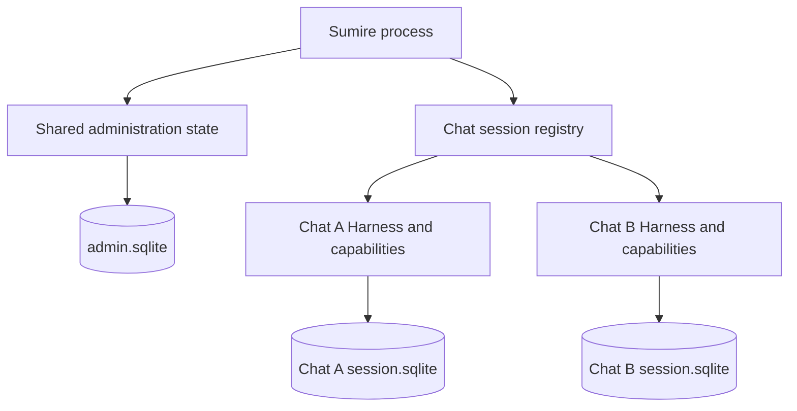

# Bot Durable Integration

Start with `../pi-session-factory.ts` for runtime construction and `session.ts` for the chat session adapter.

| Module | Responsibility |
| --- | --- |
| `session.ts` | Chat owner, explicit conversation handles, model settings, submission admission, subscriptions, forks, cancellation, and shutdown. |
| `outbox.ts` | Pending response persistence, answer capture, recovery, and delivery acknowledgement. |
| `entries.ts` | Checkpoint encoding and validation, and assistant text extraction. |
| `events.ts` | Durable event translation and retry/compaction logging. |
| `state.ts` | Persisted bot document definitions and delivery data types. |
| `tools.ts` | Native tool construction and tool result adaptation. |
| `codemode.ts` | Host authorization, tool selection, and execution deadlines around native codemode. |
| `progress.ts` | Durable progress document updates and model-facing progress context. |
| `migration.ts` | Legacy codemode store migration, fork restoration, and interrupted-call compatibility. |

## Ownership and Ordering

- Harness owns model turns, retries, compaction, transcript persistence, and tool scheduling.
- One chat owner manages one Harness and SQLite storage. Main, reply, and article handles share this owner, not another model loop.
- Each request selects its conversation explicitly. Its capture, subscriptions, progress, media, delivery mode, source message, and status message stay with that request.
- Record delivery intent before submission. Use the same request ID during recovery.
- Foreground and recovery use only the native input submission's `settled.answer`. Validate that its entry exists in the request's conversation. Save that entry ID before delivery; do not wait for conversation idle or select the last assistant entry to determine answer ownership.
  - Missing, empty, or unanswered results use the existing unavailable/no-response path. Partial media stays with its original request.
  - Private legacy steering/follow-up can wait for explicitly related work to collect its media. This does not change the original native answer. Independent group, reply, and article requests do not acquire these relationships.
  - Recovery checks the native terminal submission rather than trusting an old `answerEntryId` cache. A cached answer with no native submission cannot authorize model replay or a reply checkpoint.
- Clear all chat delivery intents before aborting its conversations. Check current outbox membership before recovery delivery.
- Only the transport acknowledges successful delivery. Acknowledgement removes delivery artifacts and releases idle handles, not conversation history needed by reply checkpoints.
- Shutdown closes all request observations and handles before the sole Harness owner. It preserves all admitted work, including branches and articles.

Document identities and formats are defined in `state.ts`, `codemode.ts`, and `migration.ts`, not by module paths.

## Session Routing

- Each `/f`, including private-chat commands, creates a fresh native conversation with `Harness.createConversation`. It is not a shared-conversation `newTurn`, does not fork main, and receives only its explicit source and attachments. `/f` takes priority over reply routing; a replied message selects source material only.
- Addressed group messages without a reply use the stable main conversation in arrival order. Busy group inputs are not implicit steering. After reopen, wait for a retained main run to become idle before submitting new main input; do not queue it behind a run that can fail and retain queued input.
- Group replies always create native checkpoint forks, even when the source is the current leaf. Replies to branch or article output fork that source conversation. Two replies to one checkpoint create separate branches and leave main unchanged.
- The bounded version-1 reply index retains the chat session identity and actual entry checkpoint:
  - Admitted user messages map to their native input entry; passive messages map to their actual write entry. Passive writes persist a typed source message ID. If an index write is lost, recovery can check up to 1,000 recent main entries for that exact source; it does not guess a checkpoint.
  - Final bot output and retained progress map to that request's answer entry.
  - Pending input/status aliases wait only for the source request's necessary settlement. Input replies use its input entry; status replies use its answer entry. A known unsent intent starts saved admission and waits for its native submission; it is not a missing-history fallback. Synthetic status text is not model context, and this wait does not require chat-wide idle.
  - A reply to a visible bot status whose send acknowledgement is still pending has a fixed two-second transport-correlation bound. An unresolved ambiguous reply returns unavailable rather than using progress text as article source. Unrelated non-reply input and known final-answer replies do not wait for this transport correlation.
  - Live final-answer classification takes priority over pending metadata through Telegram and durable acknowledgement. Confirmed final IDs use a bounded runtime cache, cleared on reset, so an acknowledgement failure does not reclassify a visible foreground answer as progress. After restart, ambiguous unacknowledged statuses remain pending until recovery confirms delivery; the bot does not infer delivery from text fragments.
- Missing, evicted, disabled, wrong-session, or invalid checkpoints use a fresh reply conversation with only the bounded reply context supplied by Telegram. Failed or cancelled dependencies without a valid checkpoint use this fallback. Do not claim restored history or substitute main's current leaf.
- Group passive context goes only to main. Register its pending source before it waits for main preprocessing. A reply fork retains its checkpoint history without copying any later passive tail; articles receive no passive context.
- Article cancellation ownership starts before asynchronous status lookup. Recheck its generation after the lookup, including failed lookups. Cancelled work cannot load sources, submit model input, publish, or send early usage and configuration notices.
- Existing authorization, addressing, bot-to-bot limits, and multiple-bot mention rules still apply. A reply to a user message must still address the bot.
- Private ordinary chat and reply navigation keep their existing behavior. Fresh `/f` isolation and exact native answer selection also apply there.

### Admission and Recovery

The fixed admission limit is four active conversation admissions shared by the whole chat: main, reply, and article work use the same slots. A slot remains held until its admitted conversation is idle. Source loading and source-checkpoint waits do not hold a chat-wide submission gate. Main retains its own arrival order.

On reopen, recovered live runs reserve slots before scheduling resumes. A foreground request resumes retained native work before waiting for its permit, so a full cold owner can free capacity. Metadata-only open does not resume work. Outbox intents interrupted before native submission queue for the same permits before new foreground work. Their admission waits do not occupy delivery slots. Foreground prompt starts admission-only recovery when a reopened owner has unsent intents and no recovery is active. Transport still owns delivery and acknowledgement; saved delivery intents remain pending. Admission work is shared by request ID with transport recovery. New input waits for older inputs in its own conversation, not for other conversations. This wait does not reserve a foreground slot. Already admitted legacy runs are retained even if they exceed four; new work waits for capacity. This limit does not discard existing work.

Outbox recovery scans request readiness independently. Unsettled runs do not occupy delivery slots. At most four recovery deliveries are active per chat; a slow article does not block an already settled main or branch response. Recovery-only owner eviction waits for pending work and active deliveries. These are transport bounds, not a second model scheduler or a global/provider concurrency or performance guarantee. Existing byte, time, tool, URL-safety, and policy limits are unchanged.

### Session Document Migration

`sumire.session` version 2 stores `mainConversation` in addition to `activeConversation`. Native document migration adopts the legacy active conversation as the initial main before scheduling. It retains the chat `sessionId`, history, forks, pending outbox, and valid reply index; it does not reconstruct an unknown historical main. Invalid state or a missing main/active conversation fails closed.

Group branches do not replace main. Private ordinary navigation retains the active-conversation behavior. The public inspector field `sumire.session.activeConversation` remains compatible: it identifies stable main for group routing and the selected conversation for private ordinary chat. No Admin UI or contracts schema change is required.

## Storage Decision

Retain shared administration storage and one Harness with independent SQLite storage for each loaded Telegram chat. This is a Sumire design choice, not a Pi Durable requirement. Pi Durable 1.5 supports multiple conversations in one Harness and table prefixes for separate logical storages in one SQLite file.



### Boundaries

- Shared administration state stays in `.telegramagent/admin.sqlite`. It includes chat metadata, policy, and managed runtime configuration. Pi-owned provider authentication files remain separate; chat databases do not isolate credentials.
- Each chat keeps `.telegramagent/sessions/<chat-id>/durable/session.sqlite`. It holds all of that chat's conversations, forks, tasks, documents, and pending responses. A conversation is not a separate database.
- `BotSessionDoc` and `OutboxDoc` have session scope. They store main/active conversation identities, the trust key, and delivery intents for one chat. Conversation purpose, progress, and codemode state have conversation scope; progress and codemode retain their checkpoint fork behavior.
- Conversation and entry IDs belong to their chat's storage. Resolve checkpoints through the owning chat and session identity, not a numeric ID alone.
- The factory creates chat-specific registries, permission guards, and MCP connections. Recovery must apply current authorization and capability identity before executing stored work.
- One active Harness owns each logical storage. Creation, inspection, recovery eviction, reset, and shutdown must coordinate through the existing session registry. Close the old owner before acquiring its replacement. SQLite transaction locks are not Pi scheduler coordination.
- Ordinary shutdown preserves admitted work in every conversation. `/cancel` withdraws all target-chat work, including main, branches, articles, pending inputs, and article source loads; `/reset` also removes that chat's stored state and reply index. Neither command affects a peer chat. Global administration invalidation still cancels cached work across chats.
- Separate databases do not isolate process memory, the tool filesystem, credentials, or host failures. Do not run multiple bot replicas against the same state directory.

### Reasons and Alternatives

Independent files match the current session-scoped state, chat-specific capabilities, and per-chat reset and close operations. They also avoid sharing a database's writer lock between chats. This is not a measured speed improvement: all chats still share the process and host resources. The costs are more files, connections, and Harness instances, plus separate reads for cross-chat history queries. Startup recovery already releases idle historical owners; this decision adds no new eviction policy.

The alternatives remain out of scope:

1. **One file with separate table prefixes:** preserves logical storage separation, but shares the SQLite writer lock and file-level failure and backup boundary. It reduces database-file count without removing per-chat Harness management.
2. **One Harness with conversations for multiple chats:** supported by Pi, but requires changes to session-scoped documents, chat ownership, outbox routing, permissions, MCP resource selection, and reset behavior. Pointing current Harness instances at the same tables is not this design.

Reconsider the layout only when a measured resource or query problem warrants the change. Do not add a new backend, migration, configuration option, or distributed owner mechanism for a hypothetical load.

## Regression Evidence

The storage audit found two gaps: persistence of both chats' selected forks and outboxes after reopen, and preservation of a peer chat during targeted cancel/reset. Three cases in `durable-runtime.test.ts` close those gaps. Existing owner-handover and recovery tests remain in use; they are not duplicated.

All paths below are relative to `apps/bot/tests/`. The SQLite tests use disposable storage and offline model/transport fixtures. Registry-only tests supplement them with controlled lifecycle races.

| Contract | Test and observable evidence |
| --- | --- |
| File paths, identity, forks, and outboxes | [`durable-runtime.test.ts`](../../../tests/durable-runtime.test.ts), `keeps chat identities, selected forks, and outboxes independent after reopen`: exact file paths; distinct session identities; both selected forks, checkpoints, and outboxes survive reopen; transcripts exclude discarded and peer context; acknowledgement in one chat leaves the peer outbox unchanged; recovery makes no new model request. |
| Targeted lifecycle commands | `durable-runtime.test.ts`, `keeps the peer chat active and its outbox intact through targeted %s`: cancel/reset leaves the peer's running request, selected fork, identity, outbox, and reply index intact across reopen; reset deletes only the target files and creates a new identity; cancel retains the target identity and history but clears its outbox. |
| Private storage | `durable-runtime.test.ts`, `reopens the same chat identity and transcript, accepts images, and keeps storage private`: directory mode `0700`, database mode `0600`, retained identity and transcript. |
| Owner handover | [`durable-inspection-lifecycle.test.ts`](../../../tests/durable-inspection-lifecycle.test.ts), `cancels and drains a recovery-only owner's read before close and blocks a second owner until close ends`: no second factory call until the old read drains and storage close finishes; replacement retains identity; eviction does not abort work. |
| Idle historical owners | `durable-runtime.test.ts`, `closes idle historical databases and lazily restores their transcript on new input`: both historical owners close; later input reopens only its chat and restores only its history. |
| Failed delivery and adoption | [`session-registry.test.ts`](../../../tests/session-registry.test.ts), `evicts only after successful recovery delivery (success=%s)` and `does not evict a recovery session adopted by a live caller`: failed delivery retains its owner and intent; a live caller prevents recovery-only eviction. |
| Failed turns and withdrawal | `durable-runtime.test.ts`, `keeps a failed turn pending and recovers its %s delivery without retrying the model` and `withdraws failed-turn delivery through explicit %s`: terminal requests are reused; cancel/reset removes the pending fallback. |
| Crash retry budget | `durable-runtime.test.ts`, `settles killed input within a %i-attempt budget`: SIGKILL consumes the attempt budget without duplicating the admitted input. |
| Unsafe effects and deadlines | [`native-codemode-runtime.test.ts`](../../../tests/native-codemode-runtime.test.ts), `resumes the journal after %s without repeating completed or interrupted unsafe effects` and its deadline case: SIGTERM/SIGKILL retain effect counts; expired deadlines prevent continuation effects. |
| Startup authorization | [`durable-startup-policy.test.ts`](../../../tests/durable-startup-policy.test.ts), `blocks still-permitted capabilities and model HTTP requests until all old scopes are cancelled` and `keeps admission independent for each chat and guards direct native capability execution`: changed-trust recovery admits no old effects; a blocked chat does not block its ready peer. |

### Focused Session-routing Verification

Verified offline focused runs cover:

- `durable-conversation-routing.test.ts`: fresh native conversations, independent execution/abort, checkpoint fork snapshots, and native document migration.
- `session-routing-migration.test.ts`: legacy selection adoption, retained identity/history/pending work, repeated opens, matching pre-upgrade backup restore, and unchanged inspector projection.
- `bot-session-routing.test.ts` with existing bot tests: independent article/main/reply transport routing and request-owned status/delivery behavior.

On 2026-11-14, Node.js 26.11.1 and npm 11.20.0 passed clean `npm ci` and all five root gates: `format:check`, `lint`, `typecheck`, `test`, and `build`. The root test run passed 3,864 tests across 222 files, including 2,101 bot tests. The existing headless Admin session-field/link test also passed. The routing suite includes real bot/registry/Harness cases, restored admission limits, pending-status/final-answer races, and cancelled-child observation cleanup. Checks used offline fixtures, not real providers, Telegram, or Morsel.

The first full run found three dependent failures: private related-media collection and two tests that assumed a prompt waited for the entire queue. Media collection remains request-owned; queue tests now wait explicitly for native idle. Final gates passed without exceptions. Only unchanged non-failing template-literal information and the Admin `localStorage` warning remain. These results do not establish production deployment, actual Logfire receipt, or live A/B/C/restart acceptance.

### Historical Storage Verification (2026-11-09)

These results predate the session-routing implementation. They are not its release gates.

Run from the repository root with Node.js 26 or newer:

```sh
npm test --workspace @narumitw/sumire -- tests/pi-session-factory.test.ts tests/session-registry.test.ts tests/durable-runtime.test.ts tests/durable-delivery.test.ts tests/durable-startup-policy.test.ts tests/durable-inspection-lifecycle.test.ts tests/native-codemode-runtime.test.ts
npm run format:check
npm run lint
npm run typecheck
npm test
npm run build
```

On Node.js 26.11.1 and npm 11.20.0, the focused run passed 115 tests across seven files. All five root checks passed; the root test run passed 3,364 tests across 209 files, including 1,904 bot tests. Checks ran in sequence without a concurrent test suite or dependency installation.

Non-failing diagnostics came from unchanged code: a Biome informational template-literal diagnostic in `packages/github-notifications/tests/review-regressions.test.ts`, and Node's experimental `localStorage` warning in the admin suite. No check was skipped or waived.

## Operations and Verification Limits

The per-chat storage layout is unchanged, but session routing upgrades `sumire.session` to version 2. Follow the [native Pi Durable upgrade and recovery procedure](../../../../../docs/pi-durable-native-upgrade.md), including its session-routing operator handoff and metadata-only comparisons. Keep one storage owner, retain the state volume, and never use `docker compose down -v`.

Current routing root gates passed as recorded above; historical results are separate. Deployment, live article/main/reply checks, and a controlled restart require separate authorization and remain unverified. Offline fixtures do not establish live provider acceptance, Telegram/Morsel delivery, production-image recovery, or performance.

Back up full consistent state, including WAL when present. Rollback before new work or external effects requires the matching old image and pre-upgrade backup; do not attach an old image to migrated state. After deliveries or other external effects, reconcile receipts and acknowledgements before a restore or retry. Already acknowledged wrong historical messages are not repaired automatically. Never delete history or reset a chat to repair this routing error.
