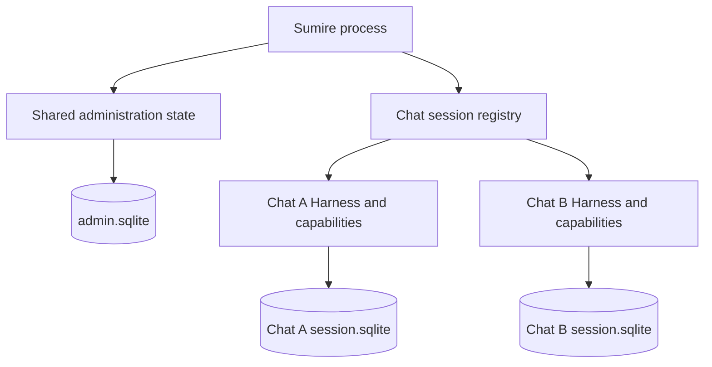

# Bot Durable Integration

Start with `../pi-session-factory.ts` for runtime construction and `session.ts` for the chat session adapter.

| Module | Responsibility |
| --- | --- |
| `session.ts` | Active conversation, model settings, input submission, subscriptions, branch restoration, cancellation, and shutdown. |
| `outbox.ts` | Pending response persistence, answer capture, recovery, and delivery acknowledgement. |
| `entries.ts` | Checkpoint encoding and validation, and assistant text extraction. |
| `events.ts` | Durable event translation and retry/compaction logging. |
| `state.ts` | Persisted bot document definitions and delivery data types. |
| `tools.ts` | Native tool construction and tool result adaptation. |
| `codemode.ts` | Host authorization, tool selection, and execution deadlines around native codemode. |
| `progress.ts` | Durable progress document updates and model-facing progress context. |
| `migration.ts` | Legacy codemode store migration, fork restoration, and interrupted-call compatibility. |

## Ownership and Ordering

- Harness owns model turns, retries, compaction, transcript persistence, and tool scheduling.
- The session owns the active conversation, conversation observations, view, cancellation epoch, and close lifecycle.
- Record delivery intent before submission. Use the same request ID during recovery.
- Wait for conversation idle before selecting the final assistant answer. Save its entry ID before delivery.
- Clear pending delivery intents before aborting the conversation. Check current outbox membership before recovery delivery.
- The transport acknowledges successful delivery. Shutdown preserves pending work.

Document identities and formats are defined in `state.ts`, `codemode.ts`, and `migration.ts`, not by module paths.

## Storage Decision

Retain shared administration storage and one Harness with independent SQLite storage for each loaded Telegram chat. This is a Sumire design choice, not a Pi Durable requirement. Pi Durable 1.5 supports multiple conversations in one Harness and table prefixes for separate logical storages in one SQLite file.



### Boundaries

- Shared administration state stays in `.telegramagent/admin.sqlite`. It includes chat metadata, policy, and managed runtime configuration. Pi-owned provider authentication files remain separate; chat databases do not isolate credentials.
- Each chat keeps `.telegramagent/sessions/<chat-id>/durable/session.sqlite`. It holds all of that chat's conversations, forks, tasks, documents, and pending responses. A conversation is not a separate database.
- `BotSessionDoc` and `OutboxDoc` have session scope. They store the selected conversation, trust key, and delivery intents for one chat. Progress and codemode documents have conversation scope and retain their existing fork behavior.
- Conversation and entry IDs belong to their chat's storage. Resolve checkpoints through the owning chat and session identity, not a numeric ID alone.
- The factory creates chat-specific registries, permission guards, and MCP connections. Recovery must apply current authorization and capability identity before executing stored work.
- One active Harness owns each logical storage. Creation, inspection, recovery eviction, reset, and shutdown must coordinate through the existing session registry. Close the old owner before acquiring its replacement. SQLite transaction locks are not Pi scheduler coordination.
- Ordinary shutdown preserves admitted work. `/cancel` withdraws target-chat work; `/reset` also removes that chat's stored state and reply index. Global administration invalidation still cancels cached work across chats.
- Separate databases do not isolate process memory, the tool filesystem, credentials, or host failures. Do not run multiple bot replicas against the same state directory.

### Reasons and Alternatives

Independent files match the current session-scoped state, chat-specific capabilities, and per-chat reset and close operations. They also avoid sharing a database's writer lock between chats. This is not a measured speed improvement: all chats still share the process and host resources. The costs are more files, connections, and Harness instances, plus separate reads for cross-chat history queries. Startup recovery already releases idle historical owners; this decision adds no new eviction policy.

The alternatives remain out of scope:

1. **One file with separate table prefixes:** preserves logical storage separation, but shares the SQLite writer lock and file-level failure and backup boundary. It reduces database-file count without removing per-chat Harness management.
2. **One Harness with conversations for multiple chats:** supported by Pi, but requires changes to session-scoped documents, chat ownership, outbox routing, permissions, MCP resource selection, and reset behavior. Pointing current Harness instances at the same tables is not this design.

Reconsider the layout only when a measured resource or query problem warrants the change. Do not add a new backend, migration, configuration option, or distributed owner mechanism for a hypothetical load.

## Regression Evidence

The storage audit found two gaps: persistence of both chats' selected forks and outboxes after reopen, and preservation of a peer chat during targeted cancel/reset. Three cases in `durable-runtime.test.ts` close those gaps. Existing owner-handover and recovery tests remain in use; they are not duplicated.

All paths below are relative to `apps/bot/tests/`. The SQLite tests use disposable storage and offline model/transport fixtures. Registry-only tests supplement them with controlled lifecycle races.

| Contract | Test and observable evidence |
| --- | --- |
| File paths, identity, forks, and outboxes | [`durable-runtime.test.ts`](../../../tests/durable-runtime.test.ts), `keeps chat identities, selected forks, and outboxes independent after reopen`: exact file paths; distinct session identities; both selected forks, checkpoints, and outboxes survive reopen; transcripts exclude discarded and peer context; acknowledgement in one chat leaves the peer outbox unchanged; recovery makes no new model request. |
| Targeted lifecycle commands | `durable-runtime.test.ts`, `keeps the peer chat active and its outbox intact through targeted %s`: cancel/reset leaves the peer's running request, selected fork, identity, outbox, and reply index intact across reopen; reset deletes only the target files and creates a new identity; cancel retains the target identity and history but clears its outbox. |
| Private storage | `durable-runtime.test.ts`, `reopens the same chat identity and transcript, accepts images, and keeps storage private`: directory mode `0700`, database mode `0600`, retained identity and transcript. |
| Owner handover | [`durable-inspection-lifecycle.test.ts`](../../../tests/durable-inspection-lifecycle.test.ts), `cancels and drains a recovery-only owner's read before close and blocks a second owner until close ends`: no second factory call until the old read drains and storage close finishes; replacement retains identity; eviction does not abort work. |
| Idle historical owners | `durable-runtime.test.ts`, `closes idle historical databases and lazily restores their transcript on new input`: both historical owners close; later input reopens only its chat and restores only its history. |
| Failed delivery and adoption | [`session-registry.test.ts`](../../../tests/session-registry.test.ts), `evicts only after successful recovery delivery (success=%s)` and `does not evict a recovery session adopted by a live caller`: failed delivery retains its owner and intent; a live caller prevents recovery-only eviction. |
| Failed turns and withdrawal | `durable-runtime.test.ts`, `keeps a failed turn pending and recovers its %s delivery without retrying the model` and `withdraws failed-turn delivery through explicit %s`: terminal requests are reused; cancel/reset removes the pending fallback. |
| Crash retry budget | `durable-runtime.test.ts`, `settles killed input within a %i-attempt budget`: SIGKILL consumes the attempt budget without duplicating the admitted input. |
| Unsafe effects and deadlines | [`native-codemode-runtime.test.ts`](../../../tests/native-codemode-runtime.test.ts), `resumes the journal after %s without repeating completed or interrupted unsafe effects` and its deadline case: SIGTERM/SIGKILL retain effect counts; expired deadlines prevent continuation effects. |
| Startup authorization | [`durable-startup-policy.test.ts`](../../../tests/durable-startup-policy.test.ts), `blocks still-permitted capabilities and model HTTP requests until all old scopes are cancelled` and `keeps admission independent for each chat and guards direct native capability execution`: changed-trust recovery admits no old effects; a blocked chat does not block its ready peer. |

### Local Verification (2026-11-09)

Run from the repository root with Node.js 26 or newer:

```sh
npm test --workspace @narumitw/sumire -- tests/pi-session-factory.test.ts tests/session-registry.test.ts tests/durable-runtime.test.ts tests/durable-delivery.test.ts tests/durable-startup-policy.test.ts tests/durable-inspection-lifecycle.test.ts tests/native-codemode-runtime.test.ts
npm run format:check
npm run lint
npm run typecheck
npm test
npm run build
```

On Node.js 26.11.1 and npm 11.20.0, the focused run passed 115 tests across seven files. All five root checks passed; the root test run passed 3,364 tests across 209 files, including 1,904 bot tests. Checks ran in sequence without a concurrent test suite or dependency installation.

Non-failing diagnostics came from unchanged code: a Biome informational template-literal diagnostic in `packages/github-notifications/tests/review-regressions.test.ts`, and Node's experimental `localStorage` warning in the admin suite. No check was skipped or waived.

## Operations and Verification Limits

This decision changes no runtime code, schema, storage path, replay policy, or authorization rule. It needs no data migration or production restart. Revert its documentation and tests without restoring a database snapshot.

Offline fixtures do not establish live provider acceptance, Telegram delivery, production-image recovery, or performance. No external verification is required to deploy documentation and test changes alone. If a later runtime change is deployed, the deployment operator must obtain authorization, retain a consistent state backup, and use configured credentials and a test chat for a controlled restart and delivery check. Verify allowed and denied chats and retained peer state before claiming production recovery or release acceptance.

Follow the existing [native Pi Durable upgrade and recovery procedure](../../../../../docs/pi-durable-native-upgrade.md) for runtime upgrades. Keep one storage owner, retain the state volume, and never use `docker compose down -v`. Pi 1.5 document upgrades still require a matching pre-upgrade backup for rollback. External effects and local delivery acknowledgements are not atomic; inspect them before an explicit retry or state restore.
