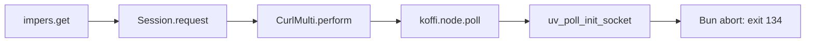

# Bun migration qualification: blocked

## Outcome

**Do not release the Bun migration.** Application compatibility task 2 did not pass. The current public impers request path crashes Bun, and restricted Bun children can reload credentials from local `.env` files. A bounded native codemode cancellation probe also did not establish worker termination.

No application source, dependency manifest, lockfile, runtime entrypoint, workflow, Docker configuration, or environment-variable name was changed. Node.js remains the supported repository runtime. This report records partial qualification, not completion of the [migration plan](../2026-10-30_bun-migration-plan.md).

## Revision and test environment

- Baseline: `342758abc56814132a26771f24c4cdbcde4b5daa` (`main`), in a clean detached validation worktree.
- Previous runtime: Node.js `26.11.1`, npm `11.20.0`.
- Candidate: Bun `1.4.4`, revision `38afee6c8`. The official latest-release API returned `bun-v1.4.4`, published on 2026-10-22. This candidate was not adopted or added to project metadata.
- Host: Linux x86_64, WSL2 kernel `6.18.33.2-microsoft-standard-WSL2`, glibc `2.43`. Bookworm and production images were not tested.
- Qualification date: 2026-10-30.

Bun probes used disposable directories, synthetic state, and local endpoints. Restricted executable paths contained Bun and selected system tools, not real Node/npm/npx executables. Some tooling probes used Bun's documented `--bun` Node-name alias; worker instrumentation verified `process.versions.bun === "1.4.4"`. Previous-runtime comparisons used an explicit Node executable as separate tests, not a fallback.

No production credentials, Telegram/model-provider requests, package publication, deployment, or release-workflow dispatch was used. Release fixtures created local test tags only in an independent disposable Git repository; no project tag was created or pushed.

## Clean Node baseline

`HUSKY=0 npm ci` passed. Husky's prepare lifecycle ran, but hook installation was disabled to preserve Git configuration shared by the validation worktree and the main checkout.

| Root command | Exit | Evidence |
| --- | ---: | --- |
| `npm run format:check` | 1 | All 12 workspace wrappers fail to resolve Biome's optional Linux x64 executable. |
| `npm run lint` | 1 | Same missing executable; source linting did not run. |
| `npm run typecheck` | 0 | All workspaces pass. |
| `npm test` | 0 | 188 files, 3,074 expanded test cases pass. |
| `npm run build` | 0 | All workspace builds pass, including compiled ESM, declarations, and Vite output. |

The existing lockfile includes the Biome platform package, but the clean npm installation does not install it. The cause remains unresolved. These two failed gates are not waived. An isolated Bun installation of the same Biome version supplies the executable and passes the baseline formatting/lint checks; it does not repair or establish success for the original npm installation.

### Prepared-tool repeat

All five root commands were then repeated from the same clean baseline with `BIOME_BINARY` pointing to the official **2.6.3** Linux executable from the isolated install. All five returned **0**, including all 3,074 tests. The existing wrapper explicitly supports this override; no source, dependency output, or lockfile was patched. Logs: `prepared-node-checks/{format:check,lint,typecheck,test,build}.log` and `status.tsv` under the local evidence root.

This repeat establishes the checks with the missing tool supplied. It does not change the original clean-install failure or establish the later migrated Bun-script gates.

Test inventory:

| Workspace | Vitest files | Expanded cases |
| --- | ---: | ---: |
| `apps/admin` | 29 | 389 |
| `apps/bot` | 115 | 1,760 |
| `packages/contracts` | 1 | 2 |
| `packages/github-notifications` | 6 | 295 |
| `packages/imagegen` | 2 | 36 |
| `packages/login` | 2 | 9 |
| `packages/pi-polymarket` | 1 | 22 |
| `packages/pi-url-reader` | 6 | 104 |
| `packages/policy` | 1 | 9 |
| `packages/progress` | 1 | 7 |
| `packages/runtime-config` | 2 | 48 |
| `packages/url-reader` | 22 | 393 |

Separate Vitest discovery finds the same 188 files and 1,756 definitions before parameter expansion. Playwright discovery finds 639 cases in 39 files; discovery is not browser acceptance.

All 12 local `npm pack --json --pack-destination <temporary-directory> --workspace <name>` commands pass. Every declared export/bin target is present. The ten shared packages contain ESM and declarations; Pi URL-reader contains both skills and its bundled script. Archive lists match pack manifests. Isolated-consumer execution remains a later gate.

## Bun qualification results

These are disposable probes against the pinned baseline dependencies. They are not integrated migration checks.

| Capability | Result and limit |
| --- | --- |
| TypeScript `7.0.2`, Vite `8.3.5`/Rolldown | All 12 type checks and dependency-first builds pass. An initial build without dependency outputs confirms that explicit build order is required. |
| Biome `2.6.3` | A clean isolated Bun install resolves the native optional executable; formatting and lint pass, with existing warnings. |
| Vitest `5.0.5` | Unmodified baseline run: 182 of 188 files pass; 3,057 cases pass and 17 fail. A disposable copy with the adaptations below passes all 3,074 cases in 189 files (one test split), with no skips. Seven dedicated mock/timer/environment/setup/isolation cases also pass under instrumented Bun workers. Retain Vitest as the candidate runner; no Bun-test conversion is justified. These are not migrated root-script results. |
| Coverage | Separately installed, pinned Vitest V8 and Istanbul providers emit fixture JSON/lcov with 100% fixture coverage. A real bot delivery-suite coverage run passes; a deliberately unmet fixture threshold exits 1. This is capability evidence, not full application coverage. |
| Playwright `1.64.1` | Discovery passes; two real admin fixture flows pass with a Bun-hosted Vite server. The full 639-case browser gate and comparison capture remain unrun. |
| Changesets `3.0.3` | An independent 12-private-workspace fixture verifies version/internal-dependency updates, Bun lock refresh/frozen install, private tags, and repeat-release no-op behavior. Unmodified action `v2.1.2` uses custom Bun scripts with GitHub/Actions stubs and consumes 12 actual `CHANGESETS_OUTPUT` events. Non-private or missing privacy metadata is rejected by the fixture guard before tagging. No real authentication, tag push, deployment trigger, public publishing, or provenance is verified. |
| Dependency updates | Local registry fixtures verify Bun recursive/latest/exact dry runs without writes and disposable updates followed by frozen install. Hosted Dependabot security-update support still needs a disposition; see below. |
| Pi environment/storage | Pinned Node-API adapters execute under Bun. Transactions, SQL functions, iteration, backup progress/deadlines, legacy imports, encrypted settings, and restart/crash recovery pass synthetic probes. |
| Cross-runtime state | Copied Node-created admin, runtime settings, durable, GitHub, and transaction state opens under Bun. Previous Node reads Bun-written copies with matching schema/encryption. DELETE hot-journal and WAL crash fixtures recover committed state under both runtimes; uncommitted writes do not survive. No live state is used. |
| Pi tools/image/codemode | Real file tools, Photon processing, Harness work with a local model fixture, native codemode, replay, and bounded CPU-loop abort/timeout probes pass. Hard termination of a non-polling native codemode operation is not qualified; see below. |
| Authorization at spawn | Six real production-factory cases pass: direct bash and codemode each allow authorized execution and reject policy revocation or credential replacement at environment materialization immediately before spawn. This does not solve automatic `.env` loading. |
| AnyDoc `0.2.4` | Real CSV/DOCX/PPTX/XLSX/PDF conversion passes, both directly and through the application child. Eval arguments, stdin, Markdown truncation, malformed PDF, pre-abort, in-flight abort, and timeout pass. Actual descendant termination and every streaming failure bound are not established by these probes. |
| PDF parsing | Actual application `readPdfContent()` with `pdf-parse 2.4.5` reads the local PDF fixture under Bun. |
| Koffi/libcurl | **Blocked:** the same local public impers request passes Node and aborts Bun with exit 134 at `uv_poll_init_socket`. |
| Telemetry | The actual application logger and pinned SDK export to a local collector. Manual spans, redaction, forceFlush, shutdown, and repeated shutdown pass. No Logfire service is contacted. |

### Required source/test adaptations identified, not implemented

- Bare `undici` resolves to Bun's built-in compatibility implementation, not the installed package. It lacks the required `Agent.close()` behavior and does not preserve the tested lookup behavior. In disposable copies, imports from installed `undici/index.js` restore both type checks and all URL-reader/Pi URL-reader suites, including DNS-rebinding assertions. Public-target and redirect defenses must remain unchanged.
- Bun does not synchronize reassigned filesystem methods through `syncBuiltinESMExports()`. The six existing late shell-revocation test cases cannot reach their injected boundary with that instrumentation. An explicitly restored Bun module mock passes all 22 shell cases in a disposable copy; independent real production-boundary probes also pass. Do not remove those assertions.
- Bun does not clear a prior `process.exitCode = 1` through assignment of `undefined` in the same way as Node. Separating the fatal/clean index cases into distinct Vitest files passes in the disposable copy with all original assertions retained. No repository test was changed.
- The disposable test adaptation needs scoped `bun-types/test` declarations, not broad Bun globals: broad Bun types change unrelated fetch types. Pinned `@types/bun`/`bun-types 1.4.4` with scoped test types pass all 12 type checks in that copy.
- An earlier adapted full run and a focused GitHub-auth API run intermittently time out in server shutdown after a streamed-size-limit test. The final adapted full run passes, but this integration risk remains open; one successful repeat does not establish stability.
- Root/workspace orchestration must make dependency order and lifecycle work explicit. Do not rely on npm pre/post-hook semantics in Bun.
- Restricted managed Bun entrypoints must prevent automatic `.env` loading, including direct binaries and descendants. `BUN_CONFIG_NO_ENVFILE=1` was tested and **does not work** in Bun 1.4.4; do not add it as a security control. Explicit `--no-env-file` works in the tested child invocation, but a complete launcher/isolation design remains unimplemented.

### Native polling blocker

The failing public call path is:



The checked native library is exactly the Docker installer's `curl-impersonate v2.2.2` Linux x86_64 GNU archive. SHA-256: `da09231c2809977266ddd00a0b60e638f8e67fc5dc97811065a185fa951a3275`. No library/dependency upgrade or dependency-output patch was used.

A minimal repro, saved as `impers-session-repro.mjs` in a disposable installed checkout:

```js
import assert from "node:assert/strict"
import { once } from "node:events"
import { createServer } from "node:http"
import { closeSharedMulti, closeSharedSession, get } from "impers"

console.log({ bun: process.versions.bun, execPath: process.execPath })
const server = createServer((_request, response) => response.end("synthetic"))
server.listen(0, "127.0.0.1")
await once(server, "listening")
try {
  const response = await get(`http://127.0.0.1:${server.address().port}/`, {
    timeout: 2,
    impersonate: "chrome",
  })
  assert.equal(response.status, 200)
} finally {
  await closeSharedSession()
  await closeSharedMulti()
  await new Promise((resolve) => server.close(resolve))
}
```

Set `LIBCURL_PATH` to the extracted, checksum-verified library and `IMPER_DOWNLOAD_LIBCURL=0`. Run the same file with the explicit previous Node executable and with `bun --no-env-file`, under separate bounded processes. Results: Node exit **0**; Bun exit **134**. Bun prints:

```text
Bun encountered a crash when running a NAPI module that tried to call
uv_poll_init_socket
panic(main thread): unsupported uv function: uv_poll_init_socket
```

[Upstream Bun issue #18546](https://github.com/oven-sh/bun/issues/18546) was open when inspected and lists the missing polling functions. This issue is related, not resolved by this work. `SessionOptions` has no public polling-implementation injection API; its polling internals are private. A passing import or use of the synchronous low-level Curl API does not qualify the application's asynchronous Session path.

### Codemode termination blocker

The bounded QuickJS expression `('a'.repeat(32 * 1024 * 1024)).indexOf('a'.repeat(32768) + 'b')` exercises a non-polling native operation. The Bun probe returns timeout and sandbox close near 151 ms, but its worker remains alive after 652 ms. The host still does not exit by the 3-second parent deadline and must be killed by the isolated probe parent. The same child program under previous Node.js `26.11.1` returns timeout/close near 152 ms, reports actual worker exit at 155 ms, and exits **0** within the same 3-second bound. The ordinary Bun `while (true)` CPU-loop timeout/abort probes do terminate their workers.

A returned timeout is therefore not evidence of hard worker termination or bounded shutdown. Keep this lifecycle gate open; do not add another model loop or silently replace supported Pi ownership boundaries.

### Dependency automation limitation

[GitHub's supported-ecosystems table](https://docs.github.com/en/code-security/dependabot/ecosystems-supported-by-dependabot/supported-ecosystems-and-repositories) lists Bun `>=1.1.39`, ecosystem `bun`, and text `bun.lock` support. Binary `bun.lockb` is not supported. Bun version updates and private registries/repositories are supported, but **Dependabot security updates are not supported**.

The current npm configuration was not changed. A future Bun configuration must not claim equivalent automatic security-update coverage. The repository owner must approve a supported replacement or a documented policy disposition before task 3 acceptance; no policy exception is inferred here.

## Remaining gates and release restrictions

Task 1 is complete with the two baseline failures recorded. Tasks 2 and 3 remain open. Dependency/entrypoint/test/container/automation/guidance migration tasks and all integrated completion checks remain open. The empty changeset covers this evidence-only PR; it does not replace the required version bumps for a future implementation affecting all workspaces.

`docker version` fails with the WSL integration error before reaching a daemon. Production images, non-root container checks, Compose health/restart, media tools, direct packaged binaries/MCP execution, full browser/comparison flows, production-only Bun installs, install-script trust, and the final no-Node execution audit are **unverified**. A later normal PR-triggered CI host could supply Docker, but no such result is claimed here.

No package manager/runtime configuration is partially migrated. Leave the original plan in place. Do not delete it, mark its completion checklist, publish packages, create project release tags, or deploy this candidate from this evidence.

## Handoff and recovery

| Responsible role | Required action | Restriction until verified |
| --- | --- | --- |
| Implementation owner and upstream runtime/native maintainers | Establish a supported Bun-only impers/native polling path and bounded codemode termination, or propose a separately reviewed compatibility design; repeat task 2 with passing evidence. | Do not retain Node fallback, remove capabilities, or weaken security/lifecycle acceptance. |
| Implementation owner | Complete explicit environment-file isolation for every managed Bun launcher and direct executable, then pass the existing security contracts and actual child probes. | A sanitized parent environment alone is not sufficient. |
| Repository/security owner | Define the dependency security-update flow before replacing npm Dependabot configuration. | Do not silently remove automatic security-update coverage. |
| Environment administrator or approved CI host | Provide an accessible Docker daemon for task 12 after prerequisite migration checks pass. | Source inspection and structural tests do not qualify production images. |
| Release/deployment operators | After all agent gates pass, retain an immutable previous image and consistent backups, then perform the separately authorized release/canary checks described in the plan. | No live acceptance, public publisher, provenance, or authentication result is established here. |

No production state changed, so no production rollback is required. Keep the current Node source/image and lockfile together. Any future rollout must preserve database schemas, encryption material, mounts, ownership, and a single state owner; stop the service before consistent backups. Never remove volumes as a rollback method.

Detailed disposable evidence is retained locally under `/tmp/sumire-bun-validation.tgbTZ3/`: `baseline-results.md`, `application-results.md`, `tooling-results.md`, `native-results.md`, command logs, package inventories/archives, and untouched Node-created synthetic fixtures. Those temporary paths are not a portable artifact or a substitute for the unresolved gates; the outcomes and critical reproducer are retained in this document.
