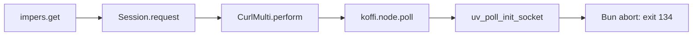

# Bun migration qualification: blocked

## Outcome

**Do not release the Bun migration.** Application compatibility task 2 still fails: the pinned impers/Koffi request path crashes the official Bun executable on Debian Bookworm. Docker access is restored. Follow-up probes qualify an inherited environment-file guard and pass four Bookworm worker-shutdown cases, but the original host shutdown risk remains. No runtime implementation was migrated.

No application source, dependency manifest, lockfile, runtime entrypoint, workflow, Docker configuration, or environment-variable name was changed. Node.js remains the supported repository runtime. This report records partial qualification, not completion of the [migration plan](../2026-10-30_bun-migration-plan.md).

## Revision and test environment

- Baseline: `342758abc56814132a26771f24c4cdbcde4b5daa` (`main`), in a clean detached validation worktree.
- Previous runtime: Node.js `26.11.1`, npm `11.20.0`.
- Candidate: Bun `1.4.4`, revision `38afee6c8`. The official latest-release API returned `bun-v1.4.4`, published on 2026-10-22. This candidate was not adopted or added to project metadata.
- Initial host: Linux x86_64, WSL2 kernel `6.18.33.2-microsoft-standard-WSL2`, glibc `2.43`. Bookworm qualification results are recorded below; complete production images remain unverified.
- Initial qualification: 2026-10-30 UTC; Docker and compatibility follow-up: 2026-10-31 UTC.

Bun probes used disposable directories, synthetic state, and local endpoints. Restricted executable paths contained Bun and selected system tools, not real Node/npm/npx executables. Some tooling probes used Bun's documented `--bun` Node-name alias; worker instrumentation verified `process.versions.bun === "1.4.4"`. Previous-runtime comparisons used an explicit Node executable as separate tests, not a fallback.

No production credentials, Telegram/model-provider requests, package publication, deployment, or release-workflow dispatch was used. Release fixtures created local test tags only in an independent disposable Git repository; no project tag was created or pushed.

## Clean Node baseline

`HUSKY=0 npm ci` passed. Husky's prepare lifecycle ran, but hook installation was disabled to preserve Git configuration shared by the validation worktree and the main checkout.

| Root command | Exit | Evidence |
| --- | ---: | --- |
| `npm run format:check` | 1 | All 12 workspace wrappers fail to resolve Biome's optional Linux x64 executable. |
| `npm run lint` | 1 | Same missing executable; source linting did not run. |
| `npm run typecheck` | 0 | All workspaces pass. |
| `npm test` | 0 | 188 files, 3,074 expanded test cases pass. |
| `npm run build` | 0 | All workspace builds pass, including compiled ESM, declarations, and Vite output. |

The existing lockfile includes the Biome platform package, but the clean npm installation does not install it. The cause remains unresolved. These two failed gates are not waived. An isolated Bun installation of the same Biome version supplies the executable and passes the baseline formatting/lint checks; it does not repair or establish success for the original npm installation.

### Prepared-tool repeat

All five root commands were then repeated from the same clean baseline with `BIOME_BINARY` pointing to the official **2.6.3** Linux executable from the isolated install. All five returned **0**, including all 3,074 tests. The existing wrapper explicitly supports this override; no source, dependency output, or lockfile was patched. Logs: `prepared-node-checks/{format:check,lint,typecheck,test,build}.log` and `status.tsv` under the local evidence root.

This repeat establishes the checks with the missing tool supplied. It does not change the original clean-install failure or establish the later migrated Bun-script gates. On 2026-10-31, all five commands also pass from the current branch's repository root with an empty temporary HOME, the same supported Biome override, and the verified native-library path. Logs: `followup-repository-checks/` under the local evidence root.

Test inventory:

| Workspace | Vitest files | Expanded cases |
| --- | ---: | ---: |
| `apps/admin` | 29 | 389 |
| `apps/bot` | 115 | 1,760 |
| `packages/contracts` | 1 | 2 |
| `packages/github-notifications` | 6 | 295 |
| `packages/imagegen` | 2 | 36 |
| `packages/login` | 2 | 9 |
| `packages/pi-polymarket` | 1 | 22 |
| `packages/pi-url-reader` | 6 | 104 |
| `packages/policy` | 1 | 9 |
| `packages/progress` | 1 | 7 |
| `packages/runtime-config` | 2 | 48 |
| `packages/url-reader` | 22 | 393 |

Separate Vitest discovery finds the same 188 files and 1,756 definitions before parameter expansion. Playwright discovery finds 639 cases in 39 files; discovery is not browser acceptance.

All 12 local `npm pack --json --pack-destination <temporary-directory> --workspace <name>` commands pass. Every declared export/bin target is present. The ten shared packages contain ESM and declarations; Pi URL-reader contains both skills and its bundled script. Archive lists match pack manifests. Isolated-consumer execution remains a later gate.

## Bun qualification results

These are disposable probes against the pinned baseline dependencies. They are not integrated migration checks.

| Capability | Result and limit |
| --- | --- |
| TypeScript `7.0.2`, Vite `8.3.5`/Rolldown | All 12 type checks and dependency-first builds pass. An initial build without dependency outputs confirms that explicit build order is required. |
| Biome `2.6.3` | A clean isolated Bun install resolves the native optional executable; formatting and lint pass, with existing warnings. |
| Vitest `5.0.5` | Unmodified baseline run: 182 of 188 files pass; 3,057 cases pass and 17 fail. A disposable copy with the adaptations below passes all 3,074 cases in 189 files (one test split), with no skips. Seven dedicated mock/timer/environment/setup/isolation cases also pass under instrumented Bun workers. Retain Vitest as the candidate runner; no Bun-test conversion is justified. These are not migrated root-script results. |
| Coverage | Separately installed, pinned Vitest V8 and Istanbul providers emit fixture JSON/lcov with 100% fixture coverage. A real bot delivery-suite coverage run passes; a deliberately unmet fixture threshold exits 1. This is capability evidence, not full application coverage. |
| Playwright `1.64.1` | Discovery passes; two real admin fixture flows pass with a Bun-hosted Vite server. The full 639-case browser gate and comparison capture remain unrun. |
| Changesets `3.0.3` | An independent 12-private-workspace fixture verifies version/internal-dependency updates, Bun lock refresh/frozen install, private tags, and repeat-release no-op behavior. Unmodified action `v2.1.2` uses custom Bun scripts with GitHub/Actions stubs and consumes 12 actual `CHANGESETS_OUTPUT` events. Non-private or missing privacy metadata is rejected by the fixture guard before tagging. No real authentication, tag push, deployment trigger, public publishing, or provenance is verified. |
| Dependency updates | Local registry fixtures verify Bun recursive/latest/exact dry runs without writes and disposable updates followed by frozen install. The repository's automatic security updates are disabled; preserve its current weekly version-update flow with Bun. Do not claim Bun security-update support. |
| Pi environment/storage | Pinned Node-API adapters execute under Bun. Transactions, SQL functions, iteration, backup progress/deadlines, legacy imports, encrypted settings, and restart/crash recovery pass synthetic probes. |
| Cross-runtime state | Copied Node-created admin, runtime settings, durable, GitHub, and transaction state opens under Bun. Previous Node reads Bun-written copies with matching schema/encryption. DELETE hot-journal and WAL crash fixtures recover committed state under both runtimes; uncommitted writes do not survive. No live state is used. |
| Pi tools/image/codemode | Real file tools, Photon processing, local-fixture Harness work, native codemode, replay, and bounded CPU-loop abort/timeout probes pass. Four Bookworm native-operation shutdown cases also pass; the same executable still exceeds the original host shutdown bound. See the platform limits below. |
| Authorization at spawn | Six real production-factory cases pass: direct bash and codemode each allow authorized execution and reject policy revocation or credential replacement at environment materialization immediately before spawn. This does not solve automatic `.env` loading. |
| AnyDoc `0.2.4` | Real CSV/DOCX/PPTX/XLSX/PDF conversion passes, both directly and through the application child. Eval arguments, stdin, Markdown truncation, malformed PDF, pre-abort, in-flight abort, and timeout pass. Actual descendant termination and every streaming failure bound are not established by these probes. |
| PDF parsing | Actual application `readPdfContent()` with `pdf-parse 2.4.5` reads the local PDF fixture under Bun. |
| Koffi/libcurl | **Blocked:** the same local public impers request passes Node 26.11.1 and aborts Bun 1.4.4 with exit 134 at `uv_poll_init_socket`, on both the original host and non-root Bookworm containers. |
| Telemetry | The actual application logger and pinned SDK export to a local collector. Manual spans, redaction, forceFlush, shutdown, and repeated shutdown pass. No Logfire service is contacted. |

### Required source/test adaptations identified, not implemented

- Bare `undici` resolves to Bun's built-in compatibility implementation, not the installed package. It lacks the required `Agent.close()` behavior and does not preserve the tested lookup behavior. In disposable copies, imports from installed `undici/index.js` restore both type checks and all URL-reader/Pi URL-reader suites, including DNS-rebinding assertions. Public-target and redirect defenses must remain unchanged.
- Bun does not synchronize reassigned filesystem methods through `syncBuiltinESMExports()`. The six existing late shell-revocation test cases cannot reach their injected boundary with that instrumentation. An explicitly restored Bun module mock passes all 22 shell cases in a disposable copy; independent real production-boundary probes also pass. Do not remove those assertions.
- Bun does not clear a prior `process.exitCode = 1` through assignment of `undefined` in the same way as Node. Separating the fatal/clean index cases into distinct Vitest files passes in the disposable copy with all original assertions retained. No repository test was changed.
- The disposable test adaptation needs scoped `bun-types/test` declarations, not broad Bun globals: broad Bun types change unrelated fetch types. Pinned `@types/bun`/`bun-types 1.4.4` with scoped test types pass all 12 type checks in that copy.
- An earlier adapted full run and a focused GitHub-auth API run intermittently time out in server shutdown after a streamed-size-limit test. The final adapted full run passes, but this integration risk remains open; one successful repeat does not establish stability.
- Root/workspace orchestration must make dependency order and lifecycle work explicit. Do not rely on npm pre/post-hook semantics in Bun.
- A supported shell adapter is now qualified in disposable copies: set the internal constant `BUN_OPTIONS: "--no-env-file"` in the restricted environment, without forwarding or appending host Bun flags. Repeated probes cover 28 CLI/descendant cases, 6 root/worker/fork observations, 30 real Harness bash/codemode cases, and 32 existing tests. Six Bookworm container controls also pass. This prevents automatic loading, not deliberate `--env-file`, file reads, or removing the option; it is not filesystem isolation. No project adapter was applied.
- Root entrypoints must disable automatic loading and select only the root `.env` explicitly. A restricted `child_process.fork()` from that host also needs clean `execArgv`, or it reloads the explicitly selected file despite a clean environment. The inspected application has no direct fork use. Bunfig settings do not protect a changed cwd. `BUN_CONFIG_NO_ENVFILE=1` does not work; do not use it as a security control.

### Native polling blocker

The failing public call path is:



The checked native library is exactly the Docker installer's `curl-impersonate v2.2.2` Linux x86_64 GNU archive. SHA-256: `da09231c2809977266ddd00a0b60e638f8e67fc5dc97811065a185fa951a3275`. No library/dependency upgrade or dependency-output patch was used.

A minimal repro, saved as `impers-session-repro.mjs` in a disposable installed checkout:

```js
import assert from "node:assert/strict"
import { once } from "node:events"
import { createServer } from "node:http"
import { closeSharedMulti, closeSharedSession, get } from "impers"

console.log({ bun: process.versions.bun, execPath: process.execPath })
const server = createServer((_request, response) => response.end("synthetic"))
server.listen(0, "127.0.0.1")
await once(server, "listening")
try {
  const response = await get(`http://127.0.0.1:${server.address().port}/`, {
    timeout: 2,
    impersonate: "chrome",
  })
  assert.equal(response.status, 200)
} finally {
  await closeSharedSession()
  await closeSharedMulti()
  await new Promise((resolve) => server.close(resolve))
}
```

Set `LIBCURL_PATH` to the extracted, checksum-verified library and `IMPER_DOWNLOAD_LIBCURL=0`. Run the same file with the explicit previous Node executable and with `bun --no-env-file`, under separate bounded processes. Results: Node exit **0**; Bun exit **134**. Bun prints:

```text
Bun encountered a crash when running a NAPI module that tried to call
uv_poll_init_socket
panic(main thread): unsupported uv function: uv_poll_init_socket
```

[Upstream Bun issue #18546](https://github.com/oven-sh/bun/issues/18546) remains unresolved. The [pinned Bun 1.4.4 source](https://github.com/oven-sh/bun/blob/bun-v1.4.4/src/jsc/bindings/uv-posix-stubs.c#L1103-L1127) unconditionally rejects POSIX poll initialization, start, and stop. The inspected main source also retains these stubs. Four fresh public API probes abort: shared `get`, a dedicated HTTP/1.1 streaming Session with AbortSignal, public `impers.fetch`, and independent `koffi.node.poll` without impers/libcurl. The Bookworm request test rules out the host's glibc version as a sufficient fix.

`SessionOptions` exposes no supported alternate poller. Pool/protocol settings and its fallback timer do not replace native polling. A synchronous Curl call would block the application's in-process validating proxy and timer/signal delivery; a buffered replacement would not preserve streaming limits. Any replacement must retain impersonation, cookies, address/redirect defenses, byte limits, cancellation, and pool ownership. No replacement, private-field patch, or dependency-output change was implemented.

### Codemode termination: host risk and target checks

On the original host, the QuickJS expression `('a'.repeat(32 * 1024 * 1024)).indexOf('a'.repeat(32768) + 'b')` returns timeout and sandbox close near 151 ms, but its worker remains alive after 652 ms. The host exceeds the 3-second external bound. Previous Node.js `26.11.1` reports actual worker exit near 155 ms and exits 0.

On Bookworm, the original case and three larger/different string-operation cases all exit 0 within the same 3-second host bound. Actual worker exits occur at 247–403 ms in the final runs; none is OOM-killed. Both the installed and image Bun binaries have SHA-256 `10702245766b225e70bbf6235fd6b47214fd94b4760d00ffaed8ab0df57ac235`. Running each matching binary again on the original host still exceeds the deadline (external timeout exit 124). The difference is environment-dependent; its cause is not established.

Do not present the initial host failure as a failed Bookworm test. The target cases pass, but they do not establish a general cross-platform shutdown guarantee or clear the observed host risk. Preserve actual worker-exit checks and Pi Harness ownership; a returned timeout alone is insufficient.

### Dependency automation limitation

[GitHub's supported-ecosystems table](https://docs.github.com/en/code-security/dependabot/ecosystems-supported-by-dependabot/supported-ecosystems-and-repositories) lists Bun `>=1.1.39`, ecosystem `bun`, and text `bun.lock` support. Binary `bun.lockb` is not supported. Bun version updates and private registries/repositories are supported, but **Dependabot security updates are not supported**.

Read-only GitHub checks on 2026-10-31 resolve the current-flow question: `GET /repos/narumiruna/sumire/automated-security-fixes` returns `{"enabled":false,"paused":false}`, and repository metadata reports `dependabot_security_updates.status: "disabled"`.

Disposition: preserve the existing configured weekly version updates with ecosystem `bun` and text `bun.lock`. No active automatic security-update flow is being removed, no GitHub setting was changed, and no replacement automation is added for a hypothetical requirement. Do not claim that Bun supports security updates; enabling that control later requires a separately supported solution. Recheck the repository setting before changing automation; if that control is enabled later, preserve it through a supported solution. The current npm configuration remains unchanged until migration. This completes task 3 qualification, not application compatibility or integrated acceptance.

## Docker follow-up (2026-10-31)

Docker Engine **29.7.2** on Docker Desktop **4.90.0** now reaches its daemon on `linux/amd64`. Built a disposable qualification image from plain Debian Bookworm and the official Bun 1.4.4 executable. It runs as uid/gid **65532**, with a read-only filesystem/mounts, tmpfs HOME, no capabilities, no new privileges, bounded resources, and no external network. Assertions verify Debian 12/glibc 2.36, Bun's actual identity, and no Node/npm/npx executable.

| Target-container check | Exit | Result |
| --- | ---: | --- |
| Qualification image build and identity | 0 | Non-root Bookworm, official pinned Bun, no Node fallback. |
| Real impers/Koffi local request | 134 | Unsupported `uv_poll_init_socket`; not an OOM or timeout. |
| Separate Node 26.11.1 Bookworm control | 0 | Same dependencies, native library, request, non-root user, and loopback-only network. This is a previous-runtime comparison, not a Bun fallback. |
| Four native codemode shutdown cases | 0 | Actual worker exits and host exit within the 3-second bound; host/platform risk remains as described above. |
| AnyDoc native/application child conversions | 0 | Five formats, real child stdin/eval, truncation, malformed PDF, abort, and timeout. |
| Application PDFParse | 0 | Real local PDF conversion. |
| Application telemetry | 0 | Local export, redaction, forceFlush, and repeated shutdown. |
| Inherited environment-file guard | 0 | Six controls; automatic loading is suppressed in nested processes, while deliberate explicit file access remains possible. |

The qualification image is `sha256:abeb2e317c2be1eb10c9ec4541a7f5eb7c13644ad54c90acd7547982aa0c7b58`. Build inputs resolve to:

- `oven/bun:1.4.4@sha256:1d22548f177f4ff38e0c15baa3c2c46c6c2060ba2d1bc573bb4720b407548f1d`.
- `debian:bookworm-slim@sha256:99c0b25c46d0214d5a2091092e7908907dcaecd6a962cde0ac700acee222b6f3`.

A minimal disposable Dockerfile for the native reproducer above is:

```dockerfile
FROM oven/bun:1.4.4@sha256:1d22548f177f4ff38e0c15baa3c2c46c6c2060ba2d1bc573bb4720b407548f1d AS bun
FROM debian:bookworm-slim@sha256:99c0b25c46d0214d5a2091092e7908907dcaecd6a962cde0ac700acee222b6f3
RUN apt-get update \
    && DEBIAN_FRONTEND=noninteractive apt-get install -y --no-install-recommends ca-certificates libstdc++6 \
    && rm -rf /var/lib/apt/lists/*
COPY --from=bun /usr/local/bin/bun /usr/local/bin/bun
RUN mkdir -p /probe/node_modules /opt/curl-impersonate
WORKDIR /probe
ENV HOME=/tmp
USER 65532:65532
ENTRYPOINT ["/usr/local/bin/bun", "--no-env-file", "--no-install"]
```

Use an empty temporary context containing that Dockerfile, `impers-session-repro.mjs`, and an empty `node_modules` mount directory. Set the following absolute paths to the disposable context, clean baseline checkout, and checksum-verified native-library directory; do not mount production environment/state or the Docker socket:

```sh
probe_image=$(docker build --quiet --platform linux/amd64 "$probe_dir")
docker run --rm --init --network=none --read-only \
  --cap-drop=ALL --security-opt=no-new-privileges --pids-limit=128 \
  --cpus=1 --memory=512m --ulimit core=0 \
  --tmpfs /tmp:rw,nosuid,nodev,size=256m,mode=1777 \
  --mount "type=bind,source=$probe_dir,target=/probe,readonly" \
  --mount "type=bind,source=$clean_checkout/node_modules,target=/probe/node_modules,readonly" \
  --mount "type=bind,source=$native_library_dir,target=/opt/curl-impersonate,readonly" \
  --env LIBCURL_PATH=/opt/curl-impersonate/libcurl-impersonate.so \
  --env IMPER_DOWNLOAD_LIBCURL=0 \
  --entrypoint /usr/bin/timeout "$probe_image" --signal=KILL 15 \
  /usr/local/bin/bun --no-env-file --no-install impers-session-repro.mjs
```

The native request is expected to abort with exit 134, not pass. The complete local runners record every command, container exit/OOM state, and cleanup. All test containers were removed; no image was pushed. This qualification image is **not** `runtime-application` or the complete production image, and it does not satisfy task 12.

## Remaining gates and release restrictions

Tasks 1 and 3 are complete with their evidence and limits recorded. Task 2 remains blocked by native compatibility and the observed host lifecycle risk. Dependency/entrypoint/test/container/automation/guidance migration tasks and all integrated completion checks remain open. The empty changeset covers this evidence-only PR; it does not replace implementation version bumps.

Production images, full non-root runtime checks, Compose health/restart, media/browser tools, direct packaged binaries/MCP, full browser/comparison flows, production-only Bun installs, install-script trust, and the final no-Node execution audit are **unverified**. Docker access is no longer the blocker; those checks depend on the preceding migration gates.

No package manager/runtime configuration is partially migrated. Leave the original plan in place. Do not delete it, mark its completion checklist, publish packages, create project release tags, or deploy this candidate from this evidence.

## Handoff and recovery

| Responsible role | Required action | Restriction until verified |
| --- | --- | --- |
| Implementation owner and upstream runtime/native maintainers | Establish a supported Bun-only native polling path; resolve the host lifecycle risk or define a verified support boundary; repeat task 2. Any replacement binding/transport needs a separately reviewed scope and compatibility decision. | Do not retain Node fallback, remove capabilities, or weaken security/lifecycle acceptance. |
| Implementation owner | Complete explicit environment-file isolation for every managed Bun launcher and direct executable, then pass the existing security contracts and actual child probes. | A sanitized parent environment alone is not sufficient. |
| Release/deployment operators | After all agent gates pass, retain an immutable previous image and consistent backups, then perform the separately authorized release/canary checks described in the plan. | No live acceptance, public publisher, provenance, or authentication result is established here. |

No production state changed, so no production rollback is required. Keep the current Node source/image and lockfile together. Any future rollout must preserve database schemas, encryption material, mounts, ownership, and a single state owner; stop the service before consistent backups. Never remove volumes as a rollback method.

Detailed disposable evidence is retained locally under `/tmp/sumire-bun-validation.tgbTZ3/`: the original baseline/application/tooling/native reports; `container/results.md`, `env-followup/results.md`, and `native-followup/results.md`; command logs, container state, package inventories/archives, and untouched Node-created synthetic fixtures. Those temporary paths are not a portable artifact or a substitute for the unresolved gates; the outcomes and critical reproducer are retained in this document.
