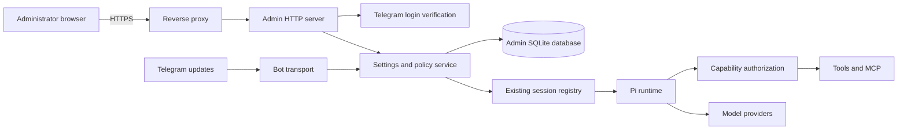

# Sumire Admin WebUI Plan

Authentication update: the administrator requested passkeys instead of Telegram Web Login. The Telegram Web Login design, fixture evidence, and acceptance checks below describe the earlier implementation and are superseded. Use [the current administration guide](../admin-webui.md) for passkey setup, schema migration, and recovery. Real passkey device enrollment and sign-in replace the old live Telegram login acceptance checks. BotFather login registration is no longer required.

## Goal

Add a public HTTPS administration interface for Sumire. Use Telegram login for the single administrator identified by `BOT_ADMIN_ID`. Support global defaults, per-chat access and capabilities, private-message access, model selection, thinking levels, and model provider management.

Use React and TypeScript with Radix Themes, Primitives, Colors, and Icons. Enforce all access rules on the server, including calls through codemode.

## Context

- `apps/bot/src/config/settings.ts` loads bootstrap environment settings and fixed runtime defaults. `BOT_WHITELIST` currently mixes user IDs and chat IDs.
- `apps/bot/src/telegram/bot.ts` checks that whitelist. Its helper permits access when the whitelist is empty, while the session factory rejects an empty whitelist. Replace this mismatch with explicit, fail-closed access rules.
- `apps/bot/src/agent/pi-session-factory.ts` builds shared base tools and loads MCP configuration before creating per-chat durable sessions. These snapshots must not retain revoked capabilities.
- `apps/bot/src/agent/session-registry.ts` owns per-chat session coordination and model mutations. Keep that coordination rather than adding a second session registry.
- `apps/bot/src/agent/model-runtime.ts` uses Pi `ModelRuntime`, stores credentials and model metadata under `.telegramagent/sessions/.pi-agent`, and selects a fixed initial model.
- `packages/login/src/oauth-login.ts` delegates provider OAuth and token persistence to Pi. This is provider authentication, not Telegram administrator login.
- `compose.yaml` runs one bot service, mounts MCP configuration read-only, and persists `.telegramagent` in the state volume. There is no web service or public ingress configuration.

## Architecture

### Ownership and deployment

- Add `apps/admin/` for the React frontend and its build and browser tests.
- Add the administration HTTP API to the bot process. Serve the built frontend and API from one origin. Keep one owner of runtime state and session changes.
- Place server modules under `apps/bot/src/admin/`. Keep policy storage and resolution separate from HTTP handlers so Telegram and the API use the same service.
- Terminate HTTPS at a reverse proxy. Publish only the HTTPS entry point; do not expose the application port directly to the public network.
- Keep model turns, retries, compaction, persistence, and tool-call loops in the existing Pi runtime integration. Do not implement another agent loop.

### State and policy

- Store versioned settings, known chat metadata, administrator sessions, and audit records in a dedicated SQLite database under `.telegramagent/`. Do not modify Pi's session database schema.
- Retain `BOT_TOKEN`, `BOT_ADMIN_ID`, and deployment bootstrap values outside editable application settings. Do not let the administrator remove the only administrator from the UI.
- Keep one authoritative provider credential store owned by Pi. Store only references and redacted credential status in administration records.
- Store additional editable secrets, if needed for MCP, outside the agent workdir with restricted permissions. Never place them in frontend bundles, audit values, or ordinary API responses.
- Resolve settings in a fixed order: global availability and ceilings, global defaults, then explicit chat overrides within those ceilings.
- Distinguish `inherit` from an explicit empty allowlist. Return the effective value and its source to the UI.
- Model groups and private conversations as chats. Keep the private-message user allowlist separate from allowed group IDs. A user allowed in private messages does not gain access in an unapproved group.
- Default new chats to denied. Newly discovered tools and MCP servers require explicit approval; do not grant them through an implicit wildcard.
- Distinguish MCP execution permission from `direct` / `codemode` / `hidden` exposure. Exposure is not authorization.
- Treat saved settings and applied runtime revisions as separate states. Display pending or failed application instead of reporting a successful runtime change prematurely.
- Use revision checks for writes to prevent stale browser forms from overwriting newer changes. Commit each setting change and its redacted audit record in one transaction.

### User interface

- **Chats:** known chat name, type and ID; enabled state; tool and MCP permissions; allowed models; default model and thinking level; inherited and effective settings; application status.
- **Access:** allowed private-message users and allowed groups, managed independently of administrator login.
- **Defaults:** global capability ceilings, default approved capabilities, model defaults, and thinking defaults.
- **Tools / MCP:** inventory, connection state, global enablement, per-tool permissions, exposure, and administrator-only server configuration. Support bounded, validated editing of the existing stdio and HTTP configuration fields; use explicit secret replacement controls.
- **Model Providers:** provider inventory, API key or supported OAuth authentication, base URL, models, model capabilities, connection tests, enablement, and credential replacement or removal.
- **Audit:** paginated records with actor, time, target, operation, revision, and outcome; no secret values or conversation contents.
- Use Radix Themes first, Primitives where Themes has no suitable component, Colors for semantic status colors, and Icons for actions. Provide keyboard access, visible focus, accessible labels, responsive layouts, and explicit loading, empty, error, and confirmation states.

### Security boundaries

- Verify Telegram login on the backend using the current official protocol. Bind login to a short-lived browser transaction and reject replay, expired credentials, invalid signatures, and unauthorized identities.
- Authorize the verified stable Telegram identity against `BOT_ADMIN_ID`, not a username or frontend-supplied ID. Missing administrator configuration disables admin access.
- Use server-side sessions with bounded idle and absolute lifetimes, rotation after login, logout revocation, and host-only `Secure`, `HttpOnly`, `SameSite` cookies.
- Enforce CSRF and Origin checks on mutations, bounded request bodies, rate limits, safe error responses, and security headers. Trust proxy headers only from the configured ingress.
- Do not permit untrusted chat input to add providers, MCP servers, commands, credentials, or permissions.
- Apply outbound URL defenses to custom provider endpoints and connection tests: public HTTP(S) targets only, no URL credentials, address and redirect validation, and bounded time and response size. Do not weaken existing URL-loading defenses.
- MCP command and endpoint management is an administrator-level execution capability. Preserve existing MCP transport safeguards; do not silently change existing deployment assumptions about internal MCP endpoints.
- Denying a tool must block execution, not only remove discovery results. Cover direct tools, codemode, dynamically discovered MCP tools, restored sessions, and queued work.
- Tool allowlists are not an OS sandbox. `bash` and file tools can bypass capability-level restrictions. Keep them disabled in new chat policies and document that enabling them requires trust.
- Do not inject provider credentials into tool environments or MCP processes. Review file mounts and process permissions: credential files readable by an agent with unrestricted shell access are not isolated merely because they are outside the workdir.

## Plan

### 1. Resolve integration contracts

- [x] Inspect the installed Pi documentation and APIs for model runtime mutation, custom providers, OAuth, supported thinking levels, and durable session updates. Record supported operations and limits in implementation tests before selecting adapters; do not assume every provider supports OAuth or live mutation.
- [x] Verify current official Telegram login requirements, domain registration, credential verification, and stable identity mapping to `BOT_ADMIN_ID`. Record the selected protocol and required deployment inputs; prove identity verification with test fixtures before building the login UI.
- [x] Specify access resolution, migration rules, and runtime application behavior. Include a race matrix for active turns, queued work, recovery, reply-tree restoration, provider changes, and revocation; approve the contract with executable policy tests.
- [x] Verify credential isolation in the current container and MCP subprocess model. Record the trust limit for unrestricted shell tools; require a tested isolation boundary before claiming that enabled shell tools cannot read credentials.

### 2. Build persistent settings and policy services

- [x] Add the administration database, schema migrations, validation, revision checks, and redacted audit writes. Test transaction rollback, invalid references, concurrent writes, restart persistence, and migration idempotence.
- [x] Import existing whitelist, MCP configuration, provider metadata references, and per-chat model settings without modifying the original files or losing transcripts. Classify positive whitelist IDs as private users and negative IDs as groups; require review because this narrows the old sender-based group access behavior. Produce an import report and test repeat startup without overwriting edits.
- [x] Implement deterministic effective-policy resolution and bounded chat inventory from Telegram updates and existing sessions. Test inheritance, empty lists, global ceilings, unknown IDs, group isolation, newly discovered capabilities, and denied users.

### 3. Enforce policy in the bot and runtime

- [x] Replace Telegram whitelist checks with the shared access service across message, callback, command, passive-context, and recovery paths. Test that denied inputs do not start sessions, process attachments, or collect passive context.
- [x] Filter capability discovery and add execution-time authorization for direct tools, codemode, and MCP discovery and calls. Test actual denied executions, including calls learned from old transcripts and calls made after policy changes.
- [x] Add revision-aware application through the existing session registry. On revocation, reject new affected operations immediately, cancel affected queued and active work where supported, and drain or close affected sessions and MCP connections without deleting history. Test races, restart recovery, failed cancellation, and honest applied-status reporting; do not claim reversal of external side effects already started.
- [x] Route Telegram model commands and WebUI changes through one settings service. Validate model allowlists and supported thinking levels; ensure branch restoration and `/reset` cannot bypass policy or delete administrator-owned chat settings. Cover these cases with regression tests.

### 4. Add model provider management

- [x] Adapt Pi's supported provider configuration and credential APIs for built-in and custom compatible providers. Support API keys, provider-supported OAuth, model metadata, credential status, and restart persistence without a second provider request loop; verify with fake runtimes and provider contract tests.
- [x] Add bounded connection and model-discovery tests with outbound URL protection and redacted errors. Distinguish authentication checks from optional billable model requests; test redirect and private-address rejection without calling live providers in unit tests.
- [x] Add provider dependency checks and explicit replacement operations. Prevent removal or disablement while defaults or chats still reference a provider unless replacements are supplied; test active sessions, unavailable models, credential rotation, and failed replacement without silent fallback.
- [x] Implement cancellable, expiring provider OAuth interactions through Pi. Verify browser-initiated login completion, denial, timeout, logout, and restart behavior; never expose provider tokens to the browser or audit log.

### 5. Add the secure administration API

- [x] Implement Telegram login, administrator authorization, sessions, and logout. Test forged identity, invalid signature, stale and replayed credentials, unauthorized users, session expiry, rotation, and revocation.
- [x] Add same-origin settings, inventory, provider, MCP, and audit endpoints with schema validation, revision conflicts, pagination, and redacted responses. Test authentication and CSRF enforcement for every route and secret replacement without secret readback.
- [x] Add login and mutation rate limits, request limits, proxy trust, safe logs, and response security headers. Test forged forwarded headers, cross-origin requests, oversized bodies, and secret-bearing upstream errors.

### 6. Build the Radix administration frontend

- [x] Add the React workspace and Radix dependencies using the root workspace lockfile and root Biome policy. Verify development, production build, asset serving, and same-origin API access.
- [x] Implement Telegram sign-in and the Chats, Access, Defaults, Tools / MCP, Model Providers, and Audit pages. Test inherited versus explicit-empty settings, write conflicts, application failures, secret replacement, and destructive-operation confirmation.
- [x] Add browser tests for sign-in, editing a chat policy, selecting a supported thinking level, configuring a provider with redacted credentials, and revoking access. Verify keyboard navigation, visible focus, dialog behavior, and mobile-width layouts.

### 7. Deploy, document, and release

- [x] Integrate HTTP startup and shutdown with `apps/bot/src/startup.ts`; keep authentication setup reachable when no model provider is authenticated. Test graceful shutdown of HTTP requests, sessions, MCP processes, and pending login interactions.
- [ ] Update deployment and verify public ingress on the registered domain. Dockerfile and the shared `compose.yaml` are complete; image build and offline Compose HTTPS smoke passed without real credentials, persistent mounts, external networking, or published ports. Public ingress and production restart acceptance require the deployment domain and administrator.
- [x] Document Telegram domain setup, administrator bootstrap, provider credentials, permissions, shell-tool trust limits, migration review, backup, session revocation, and recovery. Include required deployment values in `.env.example` without secrets.
- [x] Add release changesets for every affected package, including private packages. Run focused checks during implementation and all required root checks before release; record results and any unavailable deployment checks.

## Execution evidence

- Implementation branch: `narumi/feat/admin-webui`.
- Node.js 26.10.0 and npm 11.19.1; root `npm ci` completed.
- All five required root checks passed. `npm test`: 1,315 tests across 90 files.
- The private `/admin` command returns the WebUI link only to the bootstrap administrator, before chat approval and during pending or failed policies. Nine command tests cover authorization, disabled configuration, and the private command menu.
- Frontend browser suite: 10 fixture-based tests passed, including provider interaction, failed application, conflict handling, secret replacement, keyboard dialog behavior, and mobile width.
- Actual Pi fixture turns verify direct and codemode revocation, branch restoration, active and queued cancellation, retained transcript files, and no withdrawn tool replay after restart. A separate regression verifies that MCP-only edits cancel pre-change persisted work even when chat permissions are unchanged; serialized Telegram model commands retain the authorization epoch.
- MCP real-stdio tests verify discovery filtering, rejection of previously discovered calls after revocation, and probe working-directory parity for default and relative `cwd` values.
- Review regressions verify startup after the imported MCP source is deleted or corrupted, independent entry validation with redacted skip counts, blank-host loopback defaults, and serialized application of concurrent policy revisions. Latest-revision failures remain visible and can be retried.
- Real Pi provider contract tests verify literal key persistence, custom compatible model registration and restart restoration. OAuth completion, denial, cancellation, expiry, and restart state use test interactions, not real provider credentials.
- Signed Telegram fixtures verify stable identity, signature, issuer, audience, freshness, nonce, browser transaction consumption, and session revocation. They are not live Telegram login evidence.
- `listenr` confirmed backend `17465` and development `17466` were available. No existing service was stopped.
- Compose image build and offline HTTPS smoke passed with no environment file, persistent mounts, external network, or published ports. The smoke checks production assets, health, authentication, CSRF, logout cookies, and database restart persistence.
- Container coding tools could read a same-user mode-0600 fixture. Credential isolation is therefore not claimed. Restricted shell environment inheritance and this trust limit are documented.
- Backup restoration, failed initial migration rollback, revision/audit rollback, future-schema refusal, failed application, and cleanup failure paths have automated evidence.
- `npm audit` reports one pre-existing critical dependency: Handlebars 4.7.9 through Logfire. The base lockfile contains the same version. No unrelated dependency remediation is included; separate security review is required before production acceptance.

### Remaining external acceptance

- Supply the public HTTPS domain, register Telegram Web Login and the exact callback in BotFather, and configure login client credentials on the trusted host.
- The administrator must test real authorized and unauthorized Telegram login, selected real provider authentication, production ingress and restart behavior, and a matching image/state rollback.
- Record administrator acceptance and the disposition of the pre-existing dependency advisory. No production service, login client, provider account, or state volume was changed during local verification.
- Keep this plan while these checks are open.

## Non-Goals

- Generic OIDC identity providers, multiple administrator roles, self-registration, or public user accounts. Telegram's official OIDC flow is in scope.
- A conversation UI, transcript browser, or replacement for Telegram transport.
- Per-topic or per-user-within-group policies in the first version.
- A new agent loop, generic workflow engine, or new OS sandbox implementation.
- Guaranteed OAuth support for every provider or rollback of completed external tool actions.

## Rollback / Recovery

- Back up the administration database, Pi credential and model stores, session data, and source configuration before migration. Use a consistent database backup method; protect backups as secrets.
- Run the initial import once and preserve source files. Failed validation must leave both imported state and original files unchanged.
- If settings application fails, retain the saved revision and report its failure. Keep affected operations denied until corrected; do not silently restore a revoked permission.
- For application rollback, stop ingress and the bot, restore a compatible backup and image together, review access rules, and revoke admin sessions before reopening HTTPS. Older whitelist behavior can broaden access; never switch back without review.
- If the administrator is locked out, recover through trusted host access by correcting bootstrap configuration and revoking server-side sessions. Do not add a public bypass or password-reset endpoint.

## Completion Checklist

- [ ] A real Telegram login on the deployment domain admits only `BOT_ADMIN_ID`; unauthorized, forged, expired, and replayed logins fail.
- [x] Radix pages cover the agreed settings, show effective policy and application status, and pass browser and keyboard checks.
- [x] Direct tools, codemode, MCP, queued work, and restored sessions obey current policy; revocation race tests pass.
- [x] Private-message and group access are independent and fail closed; administrator privileges are not granted by bot access.
- [x] Providers support the verified configuration and authentication modes, persist across restart, protect secrets, and cannot be removed while unresolved references remain.
- [x] Telegram model commands and WebUI settings stay consistent, including after `/reset`, branch restoration, and restart.
- [ ] Import, backup restoration, runtime-application failure, and application rollback have recorded test evidence.
- [x] `npm run format:check`, `npm run lint`, `npm run typecheck`, `npm test`, and `npm run build` pass from the repository root on Node.js 22.19 or newer.
- [ ] Compose HTTPS smoke tests and administrator acceptance are recorded; any unavailable checks remain open with the required external action.
- [x] Documentation and package changesets are complete. Delete this plan only after every task and completion check is satisfied.
