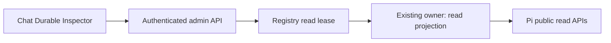

# Pi Durable Inspector Plan

Status: Implementation authorized by the user for pull request delivery on `narumi/feat/pi-durable-inspector`, based on `969f9ee` (`main` and `origin/main`). Deployment, package publication, version tags, and release workflow dispatch are not part of this implementation run. Serial `npm ci` passed on Node 26.10.0 with zero vulnerabilities; only existing transitive deprecation notices were emitted.

## Goal

Add a read-only Durable Inspector to `apps/admin/`, reached from a selected chat. Show persisted object metadata, task relationships, and explicitly allowed JSON fields without starting work, changing durable state, or exposing secrets.

The first version inspects an already loaded chat, including its idle session and historical conversations. A closed chat shows `Not loaded`; viewing it must not create a session. This limit avoids making database opening, migration, provider authentication, or MCP startup part of a read operation.

## Context

Repository baseline: `main` at `969f9ee`, after the native Pi Durable integration. The bot pins Pi Durable to 1.3.0.

| Evidence | Consequence |
| --- | --- |
| `apps/admin/src/navigation.tsx`, `chats.tsx`, `main.tsx` | Chat selection exists; no Durable page exists. Preserve navigation and unsaved policy drafts. |
| `apps/bot/src/admin/server.ts`, `application.ts` | The authenticated API has no durable inspection service. Add it behind the existing Passkey session boundary. |
| `apps/bot/src/agent/durable-session.ts` | Each loaded session owns a Harness; native views and watches already support transport. Do not expose the instance to the browser. |
| `apps/bot/src/agent/session-registry.ts` | Sessions are private. Creation, recovery eviction, reset, policy invalidation, and shutdown can change ownership. Inspection needs a bounded read lease, not `#getOrCreate`. |
| `apps/bot/src/agent/pi-session-factory.ts` | Factory creation opens SQLite, initializes state, migrates stores, and prepares capabilities. It is not a read-only inspection entry point. |
| `packages/contracts/src/index.ts` | Shared admin response types belong here; do not import bot runtime types into the frontend. |
| Pi 1.3.0 public `Storage` declarations | Conversation, task, entry, and document scans exist. Document metadata and current materialized values can be read without inventing tokens for unknown kinds. |
| Pi 1.3.0 SQLite opening code | `SqliteStorage.open` runs migrations; the Node opener is open-or-create, not a read-only connection API. Do not use it to browse closed chats. |

`taskGraph()` and `inspect()` describe live work, not complete task history. `viewState().docs` contains built-in conversation documents, not every custom document. Task-scoped documents can retire when their task ends; the UI must report unavailable data rather than reconstruct it.

## Architecture

- Add a narrow bot-owned inspection service. It returns bounded DTOs, not Harness handles, execution APIs, database paths, or raw storage access.
- Obtain loaded-session access through the registry. Coordinate the read lease with creation, eviction, reset, policy application, and shutdown; discard stale results before delivery.
- Reuse the existing owner's Harness reads and, where required, a captured read-only subset of its public Storage interface. Do not open another owner or call storage `commit`, `mintId`, or `close` from the inspection service.
- Resolve every ID in the selected chat's storage. Verify conversation, task, entry ancestry, and document scope before returning details. Numeric Pi IDs are not globally unique across chat databases.
- Apply server-side projection before serialization. Unknown document kinds are metadata-only. Administrator access does not make arbitrary object payloads safe to return.

### First-version views

| View | Included | Excluded |
| --- | --- | --- |
| Conversations | IDs, parent/fork point, ownership, active-conversation marker | Branch restoration or model execution |
| Tasks | Current and completed records, kind, status, owner ID, available timestamps; native blocking reason only if safely available | Arguments, script source, checkpoints beyond approved phase/status fields, memos, retry/replay actions |
| Documents | Kind, ID, scope, family-membership indicator, lifecycle fields, and version when returned by a supported read; expandable projected JSON for approved kinds | Raw family keys, arbitrary raw values, credentials, provider identity, trust keys, codemode store payloads, outbox content |
| Entries | Paginated record metadata, kind, role and available timestamps | Message bodies, tool output, images, instructions, transcript rendering |

Initial document value projections: approved model/provider identifiers and thinking level from `pi.agent`; numeric usage totals from `pi.usage`; active conversation ID from `sumire.session`. Other kinds remain visible as metadata with an explicit `Value withheld` reason. Do not use generic key-name redaction as permission to expose unknown payloads.

Use manual refresh. Show `Not loaded`, `Loading`, `Empty`, `Value withheld`, `Retired or unavailable`, and `Read failed` as different states. Show read time and explain that separately refreshed panels are not one atomic cross-object snapshot.

## Non-Goals

- Browse closed databases, open sessions from the Inspector, or add a second Harness/storage owner.
- Add SSE, WebSocket subscriptions, automatic polling, graphical task layouts, exports, full-text search, or arbitrary historical document queries.
- Expose message bodies, tool arguments/output, arbitrary document values, native codemode journals, or retired task data as a guaranteed archive.
- Modify, abort, replay, fork, reset, migrate, or repair anything from the Inspector.
- Add configuration flags, storage backends, migrations, or new model/tool execution paths.

## Plan

### 1. Verify the read and ownership boundary

- [x] Add disposable-storage contract tests for the selected public Harness/Storage reads; prove support for conversation ancestry, completed tasks, document scopes/families, current values, and retired documents. Record which reads can be paged and which materialize complete payloads; do not depend on private imports or SQLite table layouts. Evidence: 12 service contract/projection tests pass with real Harness/SQLite and public reads; native full-payload allocation/cancellation limits are recorded in `docs/pi-durable-inspector-validation.md`.
- [x] Prototype registry-owned read leases without opening a session; prove that unloaded chats remain unloaded and that inspect/refresh performs no durable writes, migrations, model requests, MCP startup, tool execution, or Telegram delivery. Compare records and effect counters before and after reads, not only database file size. Evidence: loaded/unloaded and in-flight creation cases pass; durable commit, stored-record, model, MCP, tool and delivery counters do not change during reads.
- [x] Test lease handoff against creation, recovery eviction, reset, policy invalidation, and shutdown; prove one owner, bounded release, and no stale result delivered after the selected generation closes. If a supported bounded read path is unavailable, record the blocker and stop before UI implementation rather than silently opening a second owner. Evidence: all 11 real-Pi lifecycle tests pass, including cancellation-ignoring reads, stale successful results and recovery close/new-owner races. No second owner is opened.

### 2. Add the bot inspection service and API

- [x] Add versioned DTOs and cursor/error contracts in `packages/contracts/`; define chat-scoped conversation, task, document, and entry metadata responses plus allowlisted document projections. Acceptance: contracts build independently and expose no runtime handles or sensitive payload fields. Evidence: shared version-1 contracts build independently. The API retains the existing sanitized `{ error: string }` HTTP error contract and documents its status codes.
- [x] Implement a focused bot read service, such as `apps/bot/src/admin/durable-inspector.ts`, through existing session ownership; prove active and idle loaded sessions work, historical records remain distinguishable from live work, absent documents are not initialized, and unknown document kinds stay metadata-only. Evidence: `durable-inspector.ts`, captured read facade, registry entry point and loaded/idle/history tests pass; unknown/family/task values remain withheld.
- [x] Add authenticated GET routes under `/api/chats/:chatId/durable`; validate signed Telegram chat IDs, positive object IDs, scope, filters, and opaque query-bound cursors. Acceptance: unauthorized access is denied, cross-chat/foreign-scope IDs reveal no records, unsupported methods cannot mutate state, and malformed IDs/cursors/path traversal do not become database paths or arbitrary queries. Evidence: six real-HTTP tests pass for authorization, unsupported methods, malformed/duplicate filters, scope mismatch, cursor binding, failures, disconnect, expiry and shutdown.
- [x] Enforce fixed server bounds: default 25/max 100 records per page, 4 KiB encoded cursor, 256 KiB serialized response, 16 KiB string and depth 12 for approved JSON projections, and one active inspection read per chat. Mark truncation explicitly; reject oversized/unavailable values without returning partial malformed JSON. Verify native synchronous materialization and cancellation limits in the contract gate instead of claiming that a timer can interrupt them. Evidence: byte-pagination, UTF-8 cursor/string limits, allowlisted fixed-depth JSON, invalid scalar rejection, document withholding and per-chat contention tests pass. No synchronous-read interruption or allocation guarantee is claimed.
- [x] Handle request disconnect, session expiry, reset, close, read failure, and record retirement; release leases in `finally`, stop admitting inspection work during shutdown, and return sanitized errors with no raw paths, SQL, payloads, or secrets. Acceptance: concurrent-read and lifecycle tests leave no retained lease or database owner. Evidence: API and lifecycle suites prove no stale delivery and no early lease release; errors omit raw values, SQL and paths.

### 3. Add the admin UI

- [x] Add a chat-scoped Durable entry and deep-link state without losing existing policy drafts; implement Conversation, Task, Document, and Entry metadata panels in a focused component such as `apps/admin/src/durable-inspector.tsx`, using the shared contracts. Acceptance: navigation, refresh/back, selected-chat changes, and the existing discard confirmation remain correct. Evidence: navigation and unit checks pass, and browser tests preserve policy drafts, discard confirmation, deep links, context and browser back/forward.
- [x] Add accessible lists and expandable JSON for server-approved fields, with page controls, parent/owner links and explicit unavailable/withheld/truncated states. Acceptance: keyboard and narrow-screen tests pass; untrusted strings render as text, never executable HTML, Markdown, or fetched URLs. Evidence: 12 focused browser scenarios pass at 1440/390/320 px with keyboard navigation, metadata/approved JSON, owner links and explicit states; withheld objects offer no value lookup.
- [x] Implement manual refresh and request cancellation; ignore late responses from a previous chat/object, clear data after session expiry, and provide an unloaded-chat explanation without a hidden wake-up request. Acceptance: delayed-response and expired-session frontend tests pass. Evidence: browser tests prove manual-only reads, aborted/stale request handling, different-chat history navigation and expiry cleanup.

### 4. Verify and document

- [x] Add end-to-end bot/API tests using separate chat databases with overlapping numeric IDs, active and completed tasks, forked conversations, pending outbox work, unknown/retired documents, large payloads, and secret sentinels. Prove no state/effect changes, scope leaks, payload leaks, or loss of existing Telegram recovery behavior. Evidence: 29 service/API/lifecycle tests pass with overlapping IDs, scopes, secrets, outbox state, record retirement and effect/commit baselines; existing durable transport tests also pass in the full root suite.
- [x] Add frontend behavior tests and a browser smoke check for loaded/idle/unloaded chats, JSON expansion, pagination, refresh, expiry, and small screens; record the tested build and results. Do not equate a frontend build test with interaction coverage. Evidence: 56 admin unit tests and all 152 browser tests pass. Final full command: `npm run test:browser --workspace @narumitw/sumire-admin -- --workers=1`; interaction evidence is recorded separately from build checks.
- [x] Document the loaded-only boundary, document allowlist, current-versus-historical semantics, resource limits, and read failure behavior in `docs/admin-webui.md`; link any necessary operator guidance without changing unrelated plans. Evidence: `docs/admin-webui.md` documents the read API, projections, units, lifecycle, limits, native allocation caveat and rollback; permanent verification is in `docs/pi-durable-inspector-validation.md`.
- [x] Add changesets for each affected package, including private bot/admin packages and shared contracts; retain no edits to runtime databases, ignored output, or unrelated user work. Evidence: `.changeset/pi-durable-inspector.md` bumps bot, admin and contracts. No package lock or dependency change is required; unrelated staged work is preserved.
- [x] Run focused tests while iterating, then all required root commands: `npm run format:check`, `npm run lint`, `npm run typecheck`, `npm test`, and `npm run build`. Record results and account for warnings; review the full diff for correctness, security, ownership/lifecycle safety, compatibility, regressions, and scope. Evidence: all five required root commands passed; 129 files / 1,703 tests; no root warnings. Both real local HTTP/browser and offline HTTPS admin smoke scripts passed. Full diff review and initial parallel-browser failures are documented in the validation report.

## Rollback / Recovery

- The feature must require no durable schema migration or state conversion. Roll back the matching bot, frontend, and contract build together.
- Drain or cancel inspection reads and release their leases before the existing owner closes. Do not abort agent work as an inspection cleanup action.
- Do not restore a database backup for a display-only rollback. If validation detects any inspection-triggered writes or effects, stop the rollout, preserve private evidence, and investigate before further access.

## Completion Checklist

- [x] Approved public read paths and registry lease behavior have passing evidence; no second owner, implicit session opening, or inspection-triggered mutation/execution exists. Evidence: public read contract gate, factory capture and registry lifecycle tests pass; no storage mutation/execution capability enters the inspection service.
- [x] All four object views work for loaded active/idle chats; unloaded, missing, retired, withheld, and truncated cases are explicit and tested. Evidence: real API tests and final 12-scenario Inspector browser smoke pass; loaded-only and withheld/retired/truncated distinctions are explicit.
- [x] Authentication, per-chat/scope isolation, field allowlists, resource bounds, cancellation, and lifecycle race tests pass with secret and external-effect sentinels. Evidence: positive and negative tests pass for scope/cursor/auth/expiry, scalar/field validation, byte bounds, read cancellation and owner close races.
- [x] Navigation, stale-response handling, accessibility, browser smoke, and existing bot/admin regressions pass. Evidence: admin units, all 152 browser tests and both administration smoke scripts pass with no changed assertions or timeouts.
- [x] Documentation, affected-package changesets, required root checks, and complete diff review have recorded evidence. Evidence: operator/validation documents, three-package changeset, final root checks and complete review have been recorded.
- [x] Deliver the authorized implementation and verification handoff; leave any unavailable acceptance check open. Delete this plan only after every task and completion check passes, and report its path. Evidence: implementation `4db4191` pushed; [PR #147](https://github.com/narumiruna/sumire/pull/147) includes verification, limitations and rollback. GitHub CI passed at https://github.com/narumiruna/sumire/actions/runs/39268675818. All tasks/checks are checked; permanent evidence remains in `docs/pi-durable-inspector-validation.md`.
