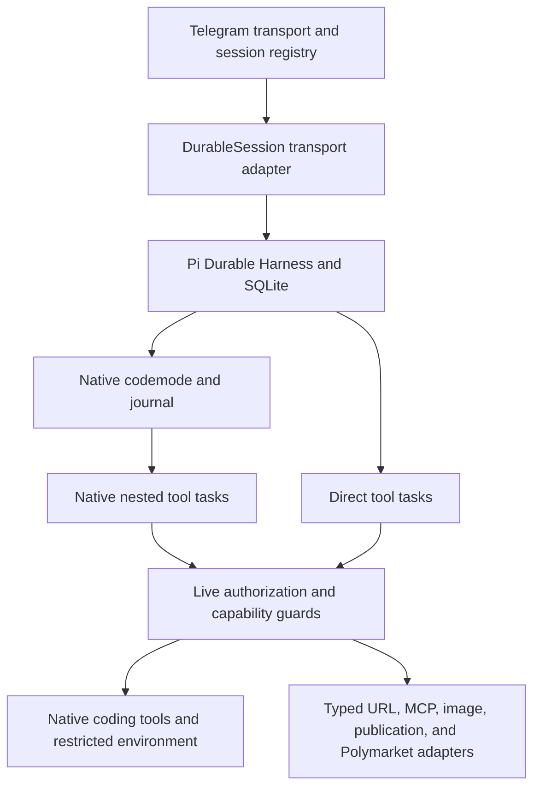

# Pi Durable Native Integration Plan

Status: Implementation and local verification passed on `narumi/refactor/pi-durable-native-integration`; pull request delivery is in progress. Production deployment and operator release acceptance remain open and are not reported as complete. Package publication, version tags, and release workflow dispatch are excluded by the user.

## Goal

Reduce bot-owned tool scheduling and codemode compatibility code by using Pi Durable's native tool and codemode APIs. Preserve authorization, bounded output, safe recovery, existing conversations, and Telegram delivery behavior.

Success means that Harness owns nested tool execution and script recovery. Sumire keeps only capability adapters and transport logic that the upstream APIs do not provide.

## Context

The bot pins `@earendil-works/pi-durable` and `@earendil-works/pi-coding-agent` to `1.3.0` in `apps/bot/package.json`.

| Repository evidence | Baseline behavior | Migration target |
| --- | --- | --- |
| `apps/bot/src/agent/pi-session-factory.ts` | Opens Harness and SQLite; installs adapted tools | Keep this ownership; install native tools and codemode |
| `apps/bot/src/agent/durable-tools.ts` | Adapts coding-agent tools and validates their calls | Native coding tools; one typed adapter for remaining external tools |
| `apps/bot/src/agent/durable-codemode.ts` | Constructs extension contexts and schedules `sumire.codemode-call` tasks | Native codemode journal and `ToolExecutionApi.executeTool` |
| `apps/bot/src/agent/durable-state.ts` | Stores rewindable `sumire.codemode-store`, progress, session identity, and outbox | Migrate only codemode state; preserve other bot-owned documents |
| `apps/bot/src/agent/durable-session.ts` | Submits input, forks conversations, restores delivery, and forwards events | Keep the transport adapter; consume native nested-call events |

The installed Pi Durable README documents native coding tools, nested calls, codemode replay, and a rewindable codemode store. Its declarations expose `output`, `structuredOutput`, `details`, `callers`, and `deferred`. These contracts differ from coding-agent tools. For example, native Bash returns `exitCode` and `fullOutputPath`, not the current snake-case fields.

At baseline, root `AGENTS.md` assigned model execution to `AgentSession` while the bot scope assigned it to Harness. The implementation resolves this conflict in favor of the verified Harness architecture, without a second agent loop.

## Architecture

- Harness owns model turns, retries, compaction, task execution, and transcript persistence.
- Sumire owns Telegram routing and delivery, per-chat policy, MCP transport, capability bounds, and secret filtering.
- Direct and nested calls must apply the same live authorization rules.
- Keep mutating and external-effect tools replay-unsafe unless tests prove that repeating them cannot duplicate effects.
- Do not treat script replay as permission to rerun an interrupted unsafe tool.

## Non-Goals

- Replace Telegram orchestration, provider configuration, MCP transports, URL-loading defenses, or the outbox.
- Remove every coding-agent dependency or change the public APIs of shared tool packages.
- Add background agents, configuration flags, or new storage backends.
- Promise exactly-once external publication or Telegram delivery.

## Plan

### 1. Establish the compatibility gate

- [x] Record a reproducible baseline from a clean, serial `npm ci` and root checks; save command results in this plan, and do not run dependency installation while tests are running. Evidence: Node 26.10.0, npm 11.19.1, base `21a4439` (equal to `origin/main`); serial `npm ci`, `npm run format:check`, `npm run lint`, `npm run typecheck`, `npm test`, and `npm run build` all exited 0. Baseline: 120 test files, 1,617 tests. Installation reported zero vulnerabilities and deprecation notices for `whatwg-encoding` and `node-domexception` (unchanged transitive dependencies). No dependency installation overlapped tests.
- [x] Build isolated native-tool and codemode contract tests against Pi `1.3.0`; record results for structured success/error output, Bash fields, image limits, model-only tools, deferred MCP discovery, namespace names, host deadlines, and sandbox shutdown. Use temporary fixture storage, not production state. Evidence: `durable-tools.test.ts` (29 contracts), `codemode.test.ts`, `codemode-session.test.ts`, `mcp-session.test.ts`, and native process tests pass against pinned 1.3.0 with disposable storage.
- [x] Test authorization changes and same-name MCP replacement during a native script; require rejection of revoked or stale calls before any side effect, as covered by `admin-turns.test.ts` and `mcp-session.test.ts`. Evidence: `admin-turns.test.ts`, `mcp-session.test.ts`, six direct-selection tests, and five startup-policy tests pass; retained or revoked selections cause no target effect.
- [x] Record a go/no-go decision for native codemode. Prove that a host deadline cannot be extended by script options and survives restart, and that `models: false` remains enforced. If a required behavior lacks a supported API, retain the smallest typed adapter and document the blocker; do not replace the scheduler with another custom loop. Evidence: GO with supported host-policy, schema, discovery-readiness, and namespace adapters; see Compatibility Decision below. CPU/script overrides, restart deadlines, and `models: false` pass.
- [x] Align the applicable `AGENTS.md` ownership rules with the verified Harness architecture; acceptance is a review with no contradictory execution owner. Evidence: root ownership now names Harness; bot scope retains only the single-owner/replay rule. No second execution owner remains.

### 2. Adopt native tool execution first

- [x] Replace adapted `read`, `write`, `edit`, and `bash` with `@earendil-works/pi-durable/tools` and a restricted execution environment; prove working-directory, shell-secret exclusion, image handling, cancellation, and output bounds in bot tests. Evidence: native tools and explicit `inheritEnv: false` in `durable-tools.ts`; 29 contract tests plus native-shell and workdir integration tests pass.
- [x] Extend the remaining capability adapter to map declared output schemas and structured values, errors, details, usage, and termination into durable contracts; prove that direct and nested calls retain their intended channels without double-counting usage. Evidence: outputSchema/structuredContent mapping, errors, UI details, usage and termination tests pass for model, nested and native script callers.
- [x] Register tool visibility with native `callers`, `deferred`, and conversation tool selection; prove that `update_progress` and `read_image` remain model-only, hidden tools remain inaccessible, and MCP discovery does not grant authorization. Evidence: native callers/deferred selection plus MCP and codemode integration tests pass. Progress and read_image are model-only.
- [x] Move per-call validation, authorization, and replay policy onto native tool execution paths; prove that direct and nested calls cannot bypass them, including registry replacement and restart recovery. Evidence: native Harness validation; execution-time guards cover live policy, prepared direct selections, script manifests, recovery, and startup cancellation. Retry and restart selection tests pass.

### 3. Migrate codemode and stored state together

Proceed only after the compatibility gate passes.

- [x] Define and test a versioned migration from `sumire.codemode-store` to the native codemode store; preserve values at historical fork points, failed-script store semantics, compaction behavior, and chat isolation. Copying only the latest values is not sufficient. Evidence: `durable-migration.ts` and 13 SQLite migration/cleanup tests pass, including historical/inherited forks, empty native state, compaction, retry and chat isolation.
- [x] Define an upgrade path for existing unsafe codemode calls and `sumire.codemode-call` tasks; drain or settle them with the old definitions before removing those definitions. Prove that no persisted task becomes orphaned and no side effect is repeated. Evidence: cleanup-only v1 task remains installed; tests prove old unsafe intent is not replayed under the new safe tool and no pending legacy task is orphaned.
- [x] Replace the custom codemode scheduler with `@earendil-works/pi-durable/codemode`; use native nested tasks, journal, and store, with `models: false`. Add `@earendil-works/pi-codemode` as a direct dependency if the selected public API requires it. Evidence: native createCodemodeTool owns all nested scheduling/journaling/store writes; direct pi-codemode 1.3.0 dependency added. models remains false.
- [x] Connect native nested-call events to Telegram progress and session events; prove correct parent linkage, cancellation, and shutdown, without duplicate synthetic start/end events. Evidence: DurableSession forwards native parent-linked results; integration and cancellation/process tests pass without synthetic tool events.
- [x] Update tool descriptions, instructions, and tests for deliberate contract changes such as Bash field names; prove that structured failures remain usable by scripts and that only model-facing output enters the transcript. Evidence: native Bash fields and structured failures tested; native prompt descriptions plus policy section and upgrade guide document deliberate contracts.
- [x] Remove obsolete extension-context casts, manual nested task scheduling, and legacy store code after migration fixtures pass; review the diff to confirm that only justified capability adapters remain. Evidence: old codemode extension and manual scheduler removed. Only read-only legacy history/fork, cleanup-only task, capability and policy adapters remain; see Compatibility Decision.

### 4. Verify and prepare release

- [x] Run bot integration tests for direct and nested tools, URL failures, MCP replacement, image output, Polymarket handles, publication, progress, reply-tree restoration, and outbox recovery; record passing commands and any approved contract changes. Evidence: complete bot suite passes (83 files, 1,129 tests), including publication, URL, image, Polymarket, progress, reply-tree and outbox paths.
- [x] Add native codemode SIGKILL and SIGTERM tests at journal and tool boundaries; prove completed effects are not repeated, interrupted unsafe tools are not re-executed, eligible scripts resume, and cancel/reset prevents continuation. Evidence: four real-process tests pass for both signals; two completion-boundary tests and cancel/reset integration tests also pass.
- [x] Run the five required root checks: `npm run format:check`, `npm run lint`, `npm run typecheck`, `npm test`, and `npm run build`; require all to pass and account for each warning. Evidence: final serial root checks all exit 0; 125 test files / 1,667 tests. No root-check warnings. See Verification Evidence.
- [x] Add changesets for every package changed by implementation, including private packages; review the dependency lockfile and retain no edits to runtime databases or generated local state. Evidence: `.changeset/pi-durable-native-integration-plan.md` bumps private `@narumitw/sumire`; lockfile adds only its already-locked pi-codemode direct dependency. No runtime database/generated files are intended for the commit.
- [x] Validate the upgrade and rollback procedure on disposable copies of representative pre-upgrade SQLite fixtures; record the tested image revisions, migration result, and recovery result. Evidence: offline old/new build-stage images and seed/upgrade/rollback fixture modes pass on copied SQLite state; image IDs below.
- [ ] Obtain explicit approval for deployment and the operator handoff; verify a controlled restart, existing reply-tree branches, pending response recovery, and no duplicate fixture side effects before release acceptance. **Blocked:** no production target or operator release handoff has been supplied for this pull-request run. Disposable fixture checks pass; they are not production approval or release acceptance.

## Compatibility Decision

GO for native execution with the following supported adapters, not for unadapted native APIs:

- Native codemode has no host-deadline option and its sandbox start ignores constructor defaults. A per-call public sandbox subclass plus durable task policy enforces the absolute deadline on every start and nested execution. Success commits check time before and after their transaction callback; committed native results remain successful after later expiry.
- Native codemode drops schema-less images. The read tool adds a typed text-or-image result schema; native image preparation and limits remain in use.
- Native nested calls select by name. Host capability generations reject stale handles. Direct selections come from the exact persisted prepared declarations, not the later registry, and update for newly prepared retries. Their schema identity annotation is stripped from provider requests.
- Native discovery freezes a script's tool table. The host retries MCP readiness first and resolves a fresh agent once; a public sandbox callback maps namespace aliases before native discovery/journaling.
- Pi 1.3.0 cannot rename historical document commits through a public API. The legacy store token remains read-only, and historical forks initialize native state in their creating transaction. Legacy nested task definitions remain cleanup-only until persisted work has settled.
- Native conversation abort resumes the global scheduler. A per-chat admission barrier blocks capabilities and model requests until all changed-trust scopes are cancelled and startup is complete.
- Native worker termination can unreference a worker before exit. The host keeps shutdown alive only while awaiting actual worker exit.

## Verification Evidence

- Host: Node 26.10.0 / npm 11.19.1. Final clean `npm ci`: exit 0, zero vulnerabilities; only unchanged transitive deprecations for `whatwg-encoding` and `node-domexception`. Dependency installation did not overlap tests.
- Final serial root commands all exited 0: `npm run format:check`, `npm run lint`, `npm run typecheck`, `npm test`, `npm run build`. All 125 test files / 1,667 tests pass; bot: 83 files / 1,129 tests. Root checks emitted no warnings.
- `node apps/bot/scripts/check-admin.mjs`: offline HTTPS, assets, passkey challenge, sessions, CSRF, logout and restart persistence pass. Same-user file access remains possible; coding tools are not a credential-isolation boundary.
- Review covered correctness, security, lifecycle, compatibility, regressions, and scope. Regression tests cover the startup cancellation race, request/preparation/retry/restart selection changes, delayed formatting/store commit, and native committed-result/outer-settlement recovery.
- Docker build-stage images (Node 26.12.0), built with `docker build --target build`:
  - Base `21a4439`: `sumire-native-baseline:21a4439`, image `sha256:f70875928105fdbc2911a10585ec16b93966a2c3790d927b4b2e00032c7f8f84`.
  - Candidate: `sumire-native-integration:fixture`, image `sha256:97024199da9269333ef72124c0f1423ca714688f303aa7feca8bb5e28f596ab1`.
  - `native-image-upgrade.mjs seed` on the base, `upgrade` on the candidate, and `rollback` on the base all pass with `--network=none`, matching source test helpers, mounted instructions, and a disposable fixture directory. The fixture proves latest/historical values, a closed SQLite backup, pending-response recovery without another model request, and restoration of the old backup. No production volumes or credentials were used.
  - Docker emitted only an npm update notice. These are build-stage fixture images, not full production runtime acceptance.
- Operator procedure and limitations: `docs/pi-durable-native-upgrade.md`. Production Telegram delivery, real external publication, a controlled production restart, and operator release acceptance remain unverified. No packages, Git version tags, or release workflows were published or dispatched.

## Rollback / Recovery

- Before production changes, stop new input and drain admitted work with the current release. Stop the process before taking a consistent SQLite backup, including state needed for WAL recovery. Keep backups outside Git and restrict access.
- Test the migration on copies first. Keep old task and document definitions until the upgrade path has settled their work. Do not delete old conversations to make migration pass.
- If migration fails before new work is admitted, stop the new process, restore the consistent backup, and start the previous image. Never run two owners against one chat database.
- After new external effects or deliveries occur, do not blindly restore an older snapshot. Reconcile effects and outbox acknowledgements first; use a forward fix if restoring would repeat work.

## Completion Checklist

- [x] Native nested execution and codemode replace the custom scheduler, or an explicit scope revision accepts an upstream blocker; a blocked migration is not reported as complete. Evidence: native Harness scheduler and codemode journal are in use; supported capability/policy adapters do not implement a model or nested-task loop.
- [x] Old conversations, fork-point store values, pending tasks, and delivery intents pass upgrade tests. Evidence: migration, delivery, historical branch, real-process and image-backed fixture checks pass.
- [x] Authorization, replay safety, output bounds, secret filtering, host deadlines, and model-only exposure pass regression tests. Evidence: native contracts, startup race, prepared selection/retry, deadline and recovery regression suites pass.
- [x] Required root checks, changesets, and upgrade/rollback rehearsal have recorded evidence. Evidence: final root checks and image rehearsal recorded below; changeset covers the only changed package.
- [ ] Deployment approval and release acceptance are recorded; no unresolved material unknown remains.
- [ ] Delete this plan only after every task and completion check passes; report its path in the completion handoff.
