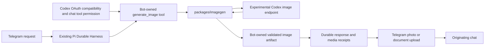

# Image Generation and Telegram Delivery Plan

Status: Tool-availability correction passes local verification; pull-request handoff is pending. External image-access, Telegram-delivery, and container acceptance items remain open. Logfire confirms that production requests did not receive `generate_image`; this is not live image-generation success evidence. Retain this plan until every open acceptance item passes.

## Goal

Add `packages/imagegen` and let the Sumire bot generate an image from a natural-language request, then send that image to the originating Telegram chat.

Image generation requires compatible `openai-codex` OAuth and the chat's tool permission, as in `@narumitw/pi-codex-imagegen`. An OpenAI API key, the separate `openai` OAuth flow, another provider's credential, or a configured login alone does not establish image access.

## Context

- `apps/bot/package.json` and `package-lock.json` pin Pi packages to `1.3.0`. The bot uses `ModelRuntime` and Pi Durable, not an `AgentSession`.
- `packages/login/src/oauth-login.ts` defaults to `runtime.login("openai", "oauth", ...)`. The pinned Pi `providers/openai.js` uses the ChatGPT subscription login and the public OpenAI API root.
- The pinned Pi `openai` and `openai-codex` providers use different OAuth flows. Image generation targets `openai-codex`; do not infer the deployed chat's provider from a source-level bootstrap default or change its text model.
- `apps/bot/src/agent/pi-session-factory.ts` owns per-chat tool construction, permissions, and the Harness registry. `apps/bot/src/admin/providers.ts` deliberately blocks unrestricted `generateImages` calls from chat runtimes.
- `apps/bot/src/agent/durable/{session,outbox,state}.ts` currently captures text answers. `apps/bot/src/telegram/{delivery,bot,recovery}.ts` delivers text and acknowledges the pending response.
- `apps/bot/src/admin/store.ts` normally enables first-seen tools. `registerTools(names, false)` supports approval-only tools without changing existing permissions.
- `Dockerfile` explicitly copies each workspace manifest and build output. `.github/workflows/ci.yml` explicitly lists workspace paths. Both need the new package.
- `compose.yaml` already persists `.telegramagent`; generated files need no new volume.

### Authentication discovery and correction (2026-10-23)

Execution branch: `narumi/feat/imagegen`, created from `origin/main` at `691ba3f`. The existing plan and empty changeset were preserved.

The user clarified that Codex OAuth is the intended credential source. The current coding session's public runtime metadata confirms `PI_PROVIDER=openai-codex`. This does not independently identify a deployed Sumire instance's credentials; the bot must check its own Pi runtime.

The earlier blocker came from interpreting “OpenAI auth” as the separate Pi provider named `openai`. OpenAI's [public OAuth limitations](https://developers.openai.com/siwc/token-sharing-open-source/preview-limitations) apply to that different route. They do not establish a blocker for the selected Codex image endpoint. No additional auth decision is required to proceed with the Codex design.

The selected reference contract is:

- Pi `openai-codex` OAuth at the canonical ChatGPT backend; Pi owns credential storage and refresh.
- `POST https://chatgpt.com/backend-api/codex/images/generations` with Bearer auth, `ChatGPT-Account-ID`, and an honest client identity.
- A JSON body containing `prompt`, `model: "gpt-image-2"`, `quality: "auto"`, `size: "auto"`, and `background: "opaque"`; omit `n` and require one `data[].b64_json` image.
- No public OpenAI API key, separate `openai` OAuth token, Codex CLI credential-file import, invented Codex turn identifiers, or automatic fallback.

`@narumitw/pi-codex-imagegen` documents this endpoint as internal and experimental. Its deterministic tests do not prove live account access. Preserve that warning and all live-verification acceptance items.

No local Sumire credential configuration or controlled Telegram target is available, and the local Docker daemon is not running. These are outstanding live/container verification conditions, not an auth-design blocker. No credential values were read and no authenticated image request was made.

### Execution evidence (initial implementation)

- `npm ci` passed with Node.js 26.10.0. `npm ls @narumitw/sumire-imagegen` resolves the bot dependency to the local private workspace. Its compiled exports import without auth or a request.
- `packages/imagegen/tests/` passes 36 deterministic client/container-validation tests with synthetic tokens and images.
- `apps/bot/tests/{imagegen,media-delivery}.test.ts` passes 42 tests, including full normal photo/document transport with a fake Telegram API, native nested codemode, partial delivery recovery, legacy text-only state, and reply-index mappings.
- An owned child process is killed with SIGKILL after committing an image. Reopening recovers its original bytes and receipt without another model or image request. Separate tests cover unsafe interrupted-call recovery, compaction, forks, queued input provenance, cancellation, reset, auth replacement/revocation, and failed atomic file publication.
- Final root checks passed: `npm run format:check`, `npm run lint`, `npm run typecheck`, `npm test`, and `npm run build`. The test run passed 2,047 tests in 151 files.
- The full diff was reviewed for correctness, fixed-destination credentials, bounded reads, private artifact ownership, lifecycle invalidation, additive state compatibility, regressions, and scope. No ordinary-intent regex route, additional model loop, URL-defense change, or unrelated package change was added.
- The package and bot READMEs document experimental access, quota and cancellation limits, the Telegram send-before-receipt duplicate window, and consistent-state rollback. Both affected private packages have a changeset.
- `npm ci` reported the existing high-severity `launch-editor` audit advisory before this feature's dependency changes. The new client has no runtime dependencies; unrelated dependency remediation was not included.
- Container blocker: `docker compose --progress plain build sumire` failed because the local Docker daemon socket is unavailable. Static packaging tests and the host import pass, but do not prove the non-root production image check.
- Live blocker: the repository has no `.env` or bot-owned Pi auth file, and `BOT_TOKEN`/`BOT_ADMIN_ID` are unset. A controlled Sumire runtime with Codex OAuth and a test chat is needed for the required real generation/delivery smoke. Do not substitute this coding session's credentials, invent access evidence, or waive these checks.

The initial implementation was handed off in PR #160, which has merged. Its external live/container acceptance items remain open; this is not a claim that all plan acceptance criteria are complete.

### Direct image-delivery follow-up (2026-10-24)

Follow-up branch: `narumi/fix/direct-image-delivery`, from `origin/main` at `97f22f3` after PR #160 merged.

- Upload generated images directly before explanatory text or Morsel publication. Slow or failed text delivery must not withhold the image.
- Preserve confirmed image receipts before sending text. Recovery retries text without regenerating or reposting the image; final response acknowledgement still requires every component.
- Updated regression tests failed against the text-first implementation, then passed after the delivery-order change. Focused delivery, imagegen, recovery, and text/Morsel checks pass 76 tests; workspace type checking also passes.
- Additional slow-publication tests prove that the image is already sent and recorded while text publication waits, and that cancellation prevents later text delivery and acknowledgement.
- All five required root commands and `npm run precommit` pass for this follow-up. The full test run passes 2,049 tests in 151 files.
- The full follow-up diff was reviewed for correctness, ownership/auth checks, partial-delivery persistence, old confirmed-text compatibility, lifecycle cancellation, and scope. Original container/live verification blockers and their unchecked acceptance items are unchanged.

### Tool-availability correction (2026-10-24)

Branch: `narumi/fix/imagegen-tool-availability`, initially from `origin/main` at `97f22f3`, then rebased onto the deployed direct-delivery branch at `9731d9a`. This correction stacks onto PR #162 and preserves image-first delivery.

- Read-only Logfire queries locate the reported requests at 2026-10-23 16:23–16:24 UTC. The first request's actual direct and Codemode inventories omit `generate_image`; the second uses the same session. No image request was made by this diagnostic.
- Deployment run `39986250414` successfully deployed `9731d9a` before these requests, so absence is not explained by an imagegen-free binary.
- A real Pi `ModelRuntime` with synthetic OAuth credentials reproduces the defect without network calls: `checkAuth("openai-codex")` returns OAuth while the unrefreshed snapshot reports no configured OAuth. The earlier imagegen tests mocked both snapshot methods and hid this case.
- Global permissions, shared defaults, explicit chat overrides, and provider requirements remain separate gates. Existing telemetry does not expose the final auth/policy decisions; do not infer production credential state from this coding session or bypass policy.

- [x] Reproduce the cold-start exclusion with the pinned runtime and inspect WebUI policy application; evidence: synthetic runtime output and the existing policy intersection and invalidation paths.
- [x] Replace snapshot-dependent imagegen gating with public, non-secret credential metadata; acceptance: real-runtime cold-start, restart, API-key replacement, logout, endpoint, and direct/Codemode tests pass without an auth probe. Evidence: `apps/bot/tests/{imagegen-availability,imagegen}.test.ts`; the cold-start test asserts zero auth resolution, availability refresh, or fetch calls.
- [x] Show imagegen capability requirements separately from policy permissions in the WebUI; acceptance: authenticated inventory, UI, and browser tests show the reason without changing selections or claiming image entitlement. Evidence: authenticated inventory checks, eight tool-permission unit tests, and twelve browser tests including 1440 px and 390 px imagegen cases pass.
- [x] Add metadata-only availability decisions to session logs; acceptance: tests distinguish auth availability, effective tool permission, and actual installation without credential or prompt disclosure. Evidence: approved OAuth, denied policy, and missing OAuth cases assert the three separate values; cold-start execution tests check that credentials are absent from logs.
- [ ] Run focused and all required root checks, update affected-package changesets and documentation, review the complete diff, and deliver a focused pull request; acceptance: recorded results and PR URL. Original live/container blockers remain open.
  - Focused bot checks pass 132 tests in seven files. After integration with PR #162, all five required root commands and `npm run precommit` pass; the root test run passes 2,066 tests in 152 files. The first full run exposed three old exact log-shape assertions; they now require the new diagnostic fields, and the full run passes.
  - Asynchronous authorization is awaited before generation, image reads, uploads, text delivery, and acknowledgement. Synchronous ownership checks remain immediately before sends. Tests cover policy changes during metadata reads, auth revocation during Morsel publication, partial-delivery acknowledgement, cancellation, and image-first delivery.
  - The complete diff was reviewed for correctness, fixed-endpoint credential safety, lifecycle invalidation, additive optional inventory compatibility, regressions, and scope. The bot README and changeset cover all three affected private packages. No policy is broadened and no runtime credential, environment flag, dependency, model loop, or output-text route is added.
  - The container build was retried and still cannot connect to the local Docker daemon. Local bot auth and `.env` remain absent; real generation and Telegram delivery were not attempted. This correction does not waive those acceptance items.

### Reference evidence

The references are design inputs, not runtime dependencies.

| Reference | Relevant behavior |
| --- | --- |
| `/Users/narumi/src/codex`, commit `d4bdafd378a8e328a67a4cd3557b5fe634af378c` | `codex-rs/codex-api/src/{images.rs,endpoint/images.rs}` defines generation requests and `data[].b64_json`. |
| Same Codex checkout | `codex-rs/ext/image-generation/src/{tool,backend}.rs` uses `gpt-image-2`, automatic size/quality, image artifacts, and separate edit requests. |
| `/Users/narumi/src/pi-extensions`, commit `25a2f40307e6b93e392bbe91ec288ce8ddec2d90` | `packages/pi-codex-imagegen/src/{image-client,artifacts}.ts` provides bounded HTTP reads, cancellation, redaction, and static-image validation. |
| Reference package `README.md` and `docs/{protocol,verification}.md` | Only legacy `openai-codex` OAuth is supported. Generic OpenAI OAuth is explicitly unsupported. The internal endpoint has not passed a live account check. |

The pinned Pi packages were inspected from their registry archives without installing workspace dependencies. Global Pi documentation is newer and is not evidence of pinned runtime behavior.

## Architecture

### Authentication and availability

- Use `openai-codex` OAuth as the required credential source, matching the user's clarification and the reference package. Do not substitute the separate `openai` OAuth flow or an API key.
- Use the fixed Codex image endpoint and protocol recorded above.
  - Validate canonical provider metadata and the resolved Codex auth before sending credentials.
  - Do not send a token to another resource, copy arbitrary provider headers, or fabricate Codex session/turn identity.
  - Treat account denials as errors. Do not retry automatically, bypass entitlement checks, or change auth to obtain success.
- Offer `generate_image` only when compatible Codex OAuth configuration is present and the chat permits the tool. Auth is a capability condition, not a replacement for authorization.
- Base this gate on the Codex credential, not merely the selected text model's provider. Do not require changing the chat model to acquire a tool.
- Remember the tool with `registerTools(["generate_image"], false)` before any default registration can enable it. The administrator enables it through the existing policy UI.
- Recheck permissions, OAuth type, cancellation, and credential compatibility before a request and after awaited authentication. Logout, credential changes, and policy changes invalidate stale access.
- Resolve and refresh credentials through public `ModelRuntime` methods. Do not read private auth files, export credentials to tool results, or weaken `chatModelRuntime` restrictions.
- Auth metadata can control availability without a billable probe. Successful login does not prove image entitlement; a denied generation remains a typed error.

### Package and tool ownership

- Create a private Node.js 26 ESM workspace named `@narumitw/sumire-imagegen`.
  - Export a small `generateImage` API that returns original image bytes, MIME type, dimensions, and a bounded request identifier.
  - Keep HTTP protocol, bounded response reading, image validation, and typed errors in this package.
  - Accept an injected auth resolver and cancellation signal. Pi owns credential refresh; the bot supplies the resolver.
  - Do not depend on Telegram, a TUI package, Codex CLI, another agent loop, or a sibling reference checkout.
- Keep `generate_image` registration, Pi auth checks, artifact persistence, and tool permissions in the bot.
  - Start with one text prompt and one image per call. The tool accepts no destination path, URL, chat ID, or credential.
  - Return a bounded typed artifact receipt through the model/program channels. Do not put full Base64 data in text or parse assistant Markdown for attachments.
  - Use the existing guarded registry and codemode paths. Register generation as `replay: "unsafe"`.
  - Use Pi's tool description to select generation from ordinary intent. Do not add keyword routing or a required Telegram command.
- Keep the endpoint fixed to the contract established in the first task. Do not add endpoint, provider, or fallback configuration for hypothetical needs.
- Apply the reference bounds where the verified endpoint permits them: 32,000 prompt characters, 32 MiB decoded output, 16,384 pixels per side, and 16,777,216 pixels total.
  - Bound streamed JSON bytes as well as decoded bytes. Reject malformed Base64, unsupported media, and animated files.
  - Use bounded static PNG/JPEG/WebP validation without claiming complete codec validation.
  - Bound authentication to 30 seconds within a maximum 300-second operation. Honor an earlier caller or codemode deadline.
  - Reject redirects and arbitrary provider headers. Do not automatically retry a generation request, including timeouts, quota errors, or transport failures.
  - Keep upstream bodies, tokens, account identifiers, prompts, and image bytes out of logs and user-facing errors.

### Durable media delivery

- Store validated originals under the chat's existing `durable` state directory with host-generated filenames and private permissions. Publish files atomically before making a receipt deliverable.
- Persist trusted media receipts with conversation, task, and input/run provenance.
  - The pinned `ToolExecutionApi` exposes `taskId`, `conversationId`, `callId`, and `commit()`. Use those capabilities instead of mutable global “current request” state.
  - Capture successful nested codemode calls even when the script does not print or return their result. Nested results do not enter the transcript.
  - Select only receipts for the completed submission. Do not scan historical image blocks or automatically send results from `read`, URL, or MCP tools.
  - Forks and compaction must not resend old artifacts or repeat remote generation.
- Extend the existing outbox with optional media and per-component delivery receipts. Old text-only records remain readable.
  - Capture the answer and its media manifest before sending. An image-only result is successful output, not `NO_RESPONSE_TEXT`.
  - Use the same media delivery function for normal replies and startup recovery.
  - Select `sendPhoto` for supported photo size/format/dimensions; otherwise upload the original with `sendDocument`. Confirm the current cloud Bot API limits before coding these checks.
  - Upload local validated bytes through grammY `InputFile`. Never ask Telegram to fetch a model-supplied URL or open a model-supplied path.
  - Upload generated images before handling explanatory text or Morsel publication. Text delays or failures must not withhold the images.
  - Keep explanatory text in the existing text/Morsel path. Do not publish image bytes to Morsel or rely on captions to carry long text.
  - Record each confirmed media/text message ID before proceeding. Record reply-tree mappings for every delivered component, but acknowledge the whole response only after all required components succeed.
  - On partial failure, preserve pending components and skip confirmed ones during recovery. Do not regenerate an image to retry delivery.
- Check current chat ownership, policy, cancellation epoch, and shutdown state before each send and after awaited work.
- Retain original bytes while any delivery is pending. After final acknowledgement, remove files with no pending references and retain small delivery receipts. Reset removes the chat's artifact directory; startup cleans incomplete temporary files.
- Telegram delivery is at least once, not exactly once. A crash or lost response after Telegram accepts an upload but before its local receipt commits can cause a duplicate. Do not add an immediate document fallback for an upload with an unknown outcome.

## Non-Goals

Image editing, reference images, masks, batches, transparent output, video, TUI menus, a new login flow, public package publication, and automatic auth/model fallback are outside this first implementation.

## Plan

### 1. Resolve the authentication contract

- [x] Verify the selected Codex image contract against the reference code and Pi `1.3.0` public auth APIs; record the endpoint, auth contract, request fields, and response fields in `packages/imagegen/README.md`. Acceptance: protocol fixtures and auth compatibility tests accept canonical `openai-codex` OAuth and reject the separate `openai` OAuth flow, API keys, and custom gateways. Keep real account access explicitly unverified until the live check passes.
- [ ] Verify the selected route with one controlled image request only after the account owner approves quota use. Acceptance: sanitized success evidence and actual image bytes, or an explicit external blocker. No permission or account access means this task stays open; do not silently switch credentials or endpoints.
- [x] Prove media provenance with the pinned Harness using a synthetic model and HTTP fixture. Acceptance: direct and nested codemode generation receipts map to the correct submitted input; concurrent chats and sibling forks cannot share or resend artifacts.

### 2. Add the generation package

- [x] Create `packages/imagegen` manifests, TypeScript/Vitest configuration, exports, README, and license. Acceptance: workspace build/typecheck/test scripts match repository conventions, use root Biome policy, and resolve no imports from the reference checkouts.
- [x] Implement the verified image client and bounded validation. Acceptance: deterministic tests cover the exact payload and allowed headers; auth failures; 401/403/429; redirects; stalled/chunked/oversized bodies; malformed images; cancellation; and zero automatic generation retries. Retain MIT notices for copied TypeScript; do not vendor the Apache-licensed Codex runtime.

### 3. Integrate the bot capability

- [x] Add the bot tool/auth adapter and register `generate_image` through `pi-session-factory.ts`. Acceptance: tests prove OAuth-gated availability, explicit policy enablement, direct/codemode parity, auth changes, cross-provider text models, and unsafe replay without broadening model permissions.
- [x] Add persistent artifact receipts and file publication in the bot's durable layer. Acceptance: tests prove ownership, fixed path confinement, atomic publication, image-only output, failed-write cleanup, and receipt survival after process restart.
- [x] Extend `DurableAnswer`, `SubmissionResult`, and the existing outbox to carry media manifests and component receipts. Acceptance: old text-only state reopens unchanged, completed media survives compaction, two pending answers cannot mix images, and a committed image is not regenerated after an interrupted final model response.

### 4. Deliver and recover images

- [x] Add deterministic Telegram photo/document selection and local uploads. Acceptance: fake grammY API tests prove byte/format/dimension boundaries, original file bytes, correct chat/reply target, image-only replies, separate long-text handling, and no automatic fallback after an ambiguous upload.
- [x] Use the shared media delivery path from `telegram/bot.ts` and `telegram/recovery.ts`. Acceptance: restart and fault-injection tests skip confirmed components, retain failed ones, delay final acknowledgement, and map all media/text messages to the correct reply checkpoint.
- [x] Add cancellation, reset, auth revocation, and artifact cleanup coverage. Acceptance: no stale send after each invalidation boundary; interrupted unsafe generation is not replayed; pending files survive shutdown; acknowledged/reset files are removed without deleting another response's files.

### 5. Package, document, and validate

- [ ] Add the package to bot dependencies/build ordering, the root lockfile, all relevant Docker build/runtime stages, and both CI path filters. Acceptance: a clean install builds the package before consumers; a container packaging test finds its manifest and compiled exports.
  - Implementation, clean install, host builds, and static Docker/CI checks pass. The actual container packaging/import check remains blocked by the unavailable Docker daemon.
- [x] Document setup, OAuth requirements, experimental limits, delivery semantics, and recovery in `README.md`, `apps/bot/README.md`, and `packages/imagegen/README.md`; add changesets for the new package and bot. Acceptance: setup requires no new secret file or environment flag, and release notes do not claim unverified endpoint support.
- [ ] Run the checks and controlled Telegram smoke below; record results and any blockers. Acceptance: every required completion item has concrete evidence before this plan is closed.
  - All five required root checks pass. Container and live account/Telegram checks remain open for the external conditions recorded above.

## Rollback / Recovery

- Before rollout, stop the bot and back up the admin database, per-chat durable databases, and pending artifact files as one consistent state snapshot.
- Disable `generate_image` through existing tool policy to stop new generation without affecting text tools.
- Keep outbox changes additive and test reopening old records. Do not assume an older binary can safely acknowledge new media-bearing records.
- Prefer a fixed release that drains pending media. If reverting the binary is required, first drain pending work or restore the consistent pre-rollout snapshot.
- Preserve pending files during recovery. Do not delete the state volume or retry an uncertain remote generation to repair delivery.
- Local cancellation does not guarantee remote cancellation or quota refund. Document the send-before-receipt duplicate window in the handoff.

## Completion Checklist

- [ ] Codex OAuth image access is verified; incompatible or missing auth keeps imagegen unavailable. Any unresolved external verification blocker keeps the feature incomplete.
- [ ] An authorized natural-language request produces an actual Telegram image, with a document upload when photo constraints do not permit a photo.
- [x] Direct and codemode invocation, image-only output, partial delivery, restart, fork, compaction, cancellation, reset, and credential revocation pass deterministic tests.
- [x] From the repository root, `npm run format:check`, `npm run lint`, `npm run typecheck`, `npm test`, and `npm run build` pass for the tool-availability correction. Evidence: 2,066 tests in 152 files; twelve focused browser tests also pass.
- [ ] From the repository root, `docker compose --progress plain build sumire` passes; the package loads as the non-root runtime user without a live request.
- [ ] With separate permission to consume quota and send to a controlled Telegram chat, one end-to-end request succeeds. Record only sanitized media/delivery evidence; stop after one clear entitlement or endpoint failure.
- [x] Documentation, affected-package changesets, additive-state compatibility, and rollback/recovery review are complete. No package is published or deployed without authorization.
- [ ] After every task and check above passes, delete this saved plan and report its path. Leave it in place while any item is open.
