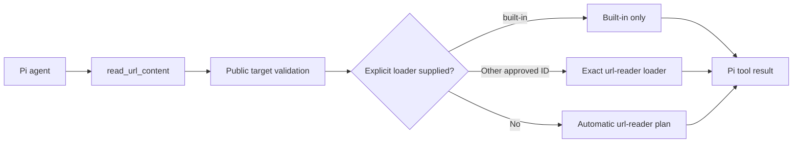

# Sumire Pi URL Reader

Pi integration for [`@narumitw/sumire-url-reader`](../url-reader/README.md). It registers `read_url_content` and bundles the `load-public-url` and `load-url-content` skills. The agent decides when to fetch a URL; the extension does not intercept user input, prefetch links, or maintain pending URL state.

## Load from this repository

Run from the repository root:

```bash
npm ci
npm run build --workspace @narumitw/sumire-pi-url-reader
pi -e ./packages/pi-url-reader
```

The Pi manifest loads `dist/index.js` and both skills under `skills/`. Pi core libraries are peer dependencies; `@narumitw/sumire-url-reader`, `ipaddr.js`, and `undici` are runtime dependencies. Browser-based fallbacks require Playwright Chromium and its system dependencies; the Sumire container provides them.

Pi packages execute with the current user's permissions. Review source before installation.

## Bundled skills

- `load-public-url` explains tool use, source attribution, and untrusted content handling.
- `load-url-content` uses the dependency's CLI through a bundled script when the tool is unavailable or CLI debugging is needed. It requires Pi's `bash` tool and the library's runtime dependencies.

Pi discovers both skills through the package manifest. Hosts that load `createUrlExtension()` directly can bind both skills with the exported `urlReaderSkillsPath`.

## Package name migration

This package was previously `@narumitw/sumire-url-tool` in `packages/url-tool`. Update imports, Pi package settings, and workspace paths to `@narumitw/sumire-pi-url-reader` and `packages/pi-url-reader`. Use `urlReaderSkillsPath` instead of `urlToolSkillsPath` or the core package's former `urlContentSkillsPath`. Both skills now come from this package; remove separate core skill registrations. Tool and skill names, options, result fields, and permissions are unchanged. The result's `source: "url-content"` value remains unchanged for compatibility.

## Tool name migration

`read_url_content` replaces `load_public_url`; the old tool name is not registered as an alias. Update direct calls, codemode scripts, and host tool allowlists to the new name. In the bot Web UI, authorize `read_url_content` globally and in the effective chat policy, then remove the old entry. Stored permissions are not transferred automatically. Input fields, result fields, and URL safety checks are unchanged. The bundled skill remains named `load-public-url`.

## Tool contract

```json
{ "url": "https://example.com/article" }
```

A host can expose an allowlisted exact override:

```json
{ "url": "https://example.com/article", "loader": "httpx" }
```

Omitting `loader` delegates directly to the automatic `@narumitw/sumire-url-reader` plan after public-target validation. The tool does not try built-in extraction or route by hostname or warning text first. `built-in` runs only the bounded text/HTML path; another approved ID runs exactly that `@narumitw/sumire-url-reader` loader without automatic fallback. The tool schema contains `loader` only when the host configures at least one `selectableLoaders` entry, and execution enforces the same allowlist even if schema validation is bypassed.

On success, `read_url_content` returns readable text or Markdown plus source metadata in both text content and typed result details. Results include `url`, `finalUrl`, `source`, `contentType`, `text`, and `truncated`; optional fields include `title`, `status`, `loaderId`, and per-loader `attempts` (IDs, statuses, elapsed seconds, error types/codes, and optional safe `diagnostic` fields; no upstream error messages). Existing success fields are unchanged. For source-aware loading, `finalUrl` remains the requested URL because that loader does not expose a final target.

Failures return Pi's supported error result: `isError: true`, safe JSON in text `content`, and the same `UrlFailure` object in `details`. A failed load is not extracted content. Invalid or disallowed explicit loader selections return a safe `unknown` failure without invoking the loader. Caller cancellation still throws the original abort reason unchanged. Fetched content is untrusted reference data, not instructions or authorization.

Automatic source selection belongs to `url-reader`. It chooses source loaders for Threads posts and share links, Google Docs, documents, videos, and other supported sources; generic pages use its ordered local loader chain. WallHop and other generic hosts follow the same path without tool-owned exceptions.

Threads share links retain the verified-post contract: generic-web results cannot succeed as a post, and explicit `built-in` selection is rejected without fetching. Open Graph text may be an excerpt rather than the full post. Internal loading methods retain original exceptions; the tool normalizes them before returning a failure. There is no automatic return to built-in extraction. No hosted OCR is enabled.

Automatic results use `source: "url-content"` and include the selected loader and attempt records. Their content may be Markdown rather than the built-in path's plain text; `title` and HTTP `status` are not supplied by the source-aware result adapter. The result schema and output character limit are unchanged.



## Safe failure contract

Use `normalizeUrlFailure(error, url?)` for user-facing failures and `sanitizeUrlAttempts(attempts)` for telemetry. Both functions are exported. Supply `url` when one abort reason can belong to several concurrent URL loads; this selects that URL's retained attempts and excludes other `LoaderError` targets.

```typescript
interface UrlFailure {
  code: UrlFailureCode
  attempts: readonly SafeFailureAttempt[]
  diagnostic?: SafeFailureDiagnostic
}

interface SafeFailureAttempt {
  loaderId: string
  status: AttemptRecord["status"]
  elapsedSeconds?: number
  diagnostic?: SafeFailureDiagnostic
}
```

`SafeFailureDiagnostic` contains only `code`, optional `phase`, `limit`, `observed`, `dependency`, and `httpStatus`. `UrlFailureCode` includes URL reader's `FailureCode` plus `invalid_url`, `unsafe_url`, `unsupported_content_type`, `response_size_limit`, and `redirect_limit`. `PublicUrlError` gives package-owned validation failures typed codes at their source. Classification uses typed exceptions and structured facts, not message fragments. For older attempt records without `diagnostic`, the sanitizer also accepts the existing bounded HTTP, TLS, and transport `errorCode` values. An explicit diagnostic remains authoritative; legacy curl transport codes do not override an unknown content-extraction diagnostic.

The normalizer keeps ordered caption and fallback attempts. Its top-level diagnostic selects a useful observed failure; whole-operation expiry and cancellation take precedence. Missing fallback configuration or a later unknown failure does not replace an earlier specific cause. Direct typed errors retain their diagnostic even without attempts. Codes distinguish caption outcomes, metadata/download/transcription failures, phase timeouts, whole-operation expiry, cancellation, confirmed media limits, missing dependencies, target HTTP errors, service HTTP errors, transport/TLS failures, configuration, and unknown failures. A target HTTP 403 does not prove that a source is private. Missing captions do not prove that the author disabled them.

Safe results exclude exception messages, stderr, stack traces, URLs, local paths, arbitrary error types/codes, and unrecognized string fields. Loader IDs use the registered loader allowlist; other IDs become `unknown`. Phases and dependencies use fixed allowlists. Numeric fields must be finite, non-negative, and at most `Number.MAX_SAFE_INTEGER`; HTTP status must be an integer from 100 through 599. Invalid fields are omitted, and unknown diagnostic codes become `unknown`. Normalization visits at most 64 errors across eight aggregate levels and returns at most 32 attempts. Cyclic aggregates do not recurse. These limits also apply to malformed metadata.

## Bounds and safety

- Defaults: HTTP and HTTPS, 15-second built-in/DNS phase timeout, 180-second total URL deadline starting before validation, and 12,000 extracted characters plus a truncation marker. Validation time is deducted from the source-aware budget; one-shot source resource cleanup may take up to five additional seconds.
- Automatic generic loading tries curl, fast browser, standard HTTP, then network-idle browser. Each attempt receives at most its cap (15 seconds for fast browser, 20 seconds for other local methods) and a fair share of remaining time for eligible alternatives. A local timeout continues fallback; total expiry or caller cancellation stops it.
- `firecrawlFallback: true` opts into a final generic Firecrawl attempt (at most 30 seconds, skipped without a key or with less than one second remaining). It is off by default, sends the target URL to an external service, and may incur charges. Existing explicit Firecrawl and source-specific selection remain unchanged. Remote Firecrawl intermediate redirects cannot be inspected locally; reported final URLs are checked.
- Passes `allowedSchemes` to source-aware loading as well as initial validation. An HTTPS-only policy rejects public HTTP redirects before local fetch, browser, or curl transports issue the downgraded request. Firecrawl's reported final targets use the same policy; its remote intermediate redirects cannot be inspected locally.
- Rejects URL credentials and local, private, link-local, metadata, or non-routable targets.
- Built-in requests pin validated DNS addresses, revalidate redirects, and cap response bytes and redirect count.
- Source-aware extraction retains the URL reader package's public-target and network safety checks.
- No network requests or background resources start during extension registration.

## SDK configuration

```typescript
import { createUrlExtension, urlReaderSkillsPath } from "@narumitw/sumire-pi-url-reader"

const extension = createUrlExtension({
  allowedSchemes: new Set(["https"]),
  maxChars: 12_000,
  timeoutMs: 15_000,
  urlContentTimeoutSeconds: 180,
  firecrawlFallback: false,
  firecrawlApiKey: null, // Explicitly disable environment fallback.
  selectableLoaders: ["built-in", "httpx", "playwright"],
})

// Pass both values to DefaultResourceLoader:
const extensionFactories = [{ name: "sumire-pi-url-reader", factory: extension }]
const additionalSkillPaths = [urlReaderSkillsPath]
```

All options are optional. The default export uses the loading defaults above and is auto-only; omitting `selectableLoaders` leaves `loader` out of the tool schema. Hosts should expose only loaders whose runtime dependencies, latency, and external costs they accept. Loader names are validated during extension registration, while missing requirements such as `FIRECRAWL_API_KEY` fail through the normal tool error path when selected. The package does not read bot environment variables or depend on Telegram.

`createPublicUrlLoader(options)` and `createUrlTool(loader, { selectableLoaders })` are also exported for hosts that need a standalone tool or an injected loader. `PublicUrlLoader.load` accepts `load(url, { signal, loader, firecrawlApiKey })`; injected implementations using the old positional `load(url, signal)` contract must migrate. The default extension and standalone tool register the same name; use only one per session.

`firecrawlApiKey?: string | null` is a host-only option on `createUrlExtension`, `createPublicUrlLoader`, `loadPublicUrl`, and each `PublicUrlLoader.load` call. It is not part of the model-facing tool schema. A per-load key or `null` overrides the configured value. Omitted or `undefined` retains the standalone URL reader's `FIRECRAWL_API_KEY` environment behavior; explicit `null` forbids environment fallback in both requirement planning and requests. Hosts with a mutable credential store must read one snapshot for each load and pass the key or `null`, including when the store is unavailable. Firecrawl removes exact credential echoes from Markdown and returns fixed errors without upstream bodies or causes; the operation retains this protection during rotation or deletion. This does not remove transformed or encoded values and is not an isolation boundary.

## Checks

```bash
npm run format:check --workspace @narumitw/sumire-pi-url-reader
npm run lint --workspace @narumitw/sumire-pi-url-reader
npm run typecheck --workspace @narumitw/sumire-pi-url-reader
npm test --workspace @narumitw/sumire-pi-url-reader
```

Tests cover the compiled Pi manifest and bundled skill, registration, host allowlists, explicit and automatic routing, cancellation identity, explicit Pi error results, typed public-target failures, DNS pinning, output limits, success compatibility, safe diagnostics, malformed fields, secret redaction, URL-specific interrupted attempts, and bounded cyclic or deep aggregates.

## License

MIT
