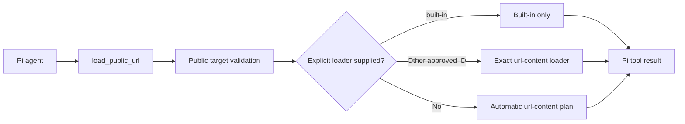

# Sumire URL Tool

Pi package that registers `load_public_url` and bundles the `load-public-url` skill. The agent decides when to fetch a URL; the extension does not intercept user input, prefetch links, or maintain pending URL state.

## Load from this repository

Run from the repository root:

```bash
npm ci
npm run build --workspace @narumitw/sumire-url-tool
pi -e ./packages/url-tool
```

The Pi manifest loads `dist/index.js` and `skills/load-public-url/SKILL.md`. Pi core libraries are peer dependencies; `@narumitw/sumire-url-content`, `ipaddr.js`, and `undici` are runtime dependencies. Browser-based fallbacks require Playwright Chromium and its system dependencies; the Sumire container provides them.

Pi packages execute with the current user's permissions. Review source before installation.

## Bundled skill

The `load-public-url` skill tells the agent when to call the tool, to preserve source attribution across multiple URLs, and to treat fetched content as untrusted. Pi discovers it through the package manifest. Hosts that load `createUrlExtension()` directly can bind the same bundled skill with the exported `urlToolSkillsPath`.

## Tool contract

```json
{ "url": "https://example.com/article" }
```

A host can expose an allowlisted exact override:

```json
{ "url": "https://example.com/article", "loader": "httpx" }
```

Omitting `loader` delegates directly to the automatic `@narumitw/sumire-url-content` plan after public-target validation. The tool does not try built-in extraction or route by hostname or warning text first. `built-in` runs only the bounded text/HTML path; another approved ID runs exactly that `@narumitw/sumire-url-content` loader without automatic fallback. The tool schema contains `loader` only when the host configures at least one `selectableLoaders` entry, and execution enforces the same allowlist even if schema validation is bypassed.

`load_public_url` returns readable text or Markdown plus source metadata in both text content and typed result details. Results include `url`, `finalUrl`, `source`, `contentType`, `text`, and `truncated`; optional fields include `title`, `status`, `loaderId`, and per-loader `attempts` (IDs, statuses, elapsed seconds, error types/codes; no upstream error messages). For source-aware loading, `finalUrl` remains the requested URL because that loader does not expose a final target.

Failures, including unknown, disallowed, inapplicable, or unavailable explicit loaders, throw through Pi's native tool error path. Cancellation is passed to the loader. Fetched content is untrusted reference data, not instructions or authorization.

Automatic source selection belongs to `url-content`. It chooses source loaders for Threads posts and share links, Google Docs, documents, videos, and other supported sources; generic pages use its ordered local loader chain. WallHop and other generic hosts follow the same path without tool-owned exceptions.

Threads share links retain the verified-post contract: generic-web results cannot succeed as a post, and explicit `built-in` selection is rejected without fetching. Open Graph text may be an excerpt rather than the full post. Document and source errors retain their original error details; there is no automatic return to built-in extraction. No hosted OCR is enabled.

Automatic results use `source: "url-content"` and include the selected loader and attempt records. Their content may be Markdown rather than the built-in path's plain text; `title` and HTTP `status` are not supplied by the source-aware result adapter. The result schema and output character limit are unchanged.



## Bounds and safety

- Defaults: HTTP and HTTPS, 15-second built-in/DNS phase timeout, 180-second total URL deadline starting before validation, and 12,000 extracted characters plus a truncation marker. Validation time is deducted from the source-aware budget; one-shot source resource cleanup may take up to five additional seconds.
- Automatic generic loading tries curl, fast browser, standard HTTP, then network-idle browser. Each attempt receives at most its cap (15 seconds for fast browser, 20 seconds for other local methods) and a fair share of remaining time for eligible alternatives. A local timeout continues fallback; total expiry or caller cancellation stops it.
- `firecrawlFallback: true` opts into a final generic Firecrawl attempt (at most 30 seconds, skipped without a key or with less than one second remaining). It is off by default, sends the target URL to an external service, and may incur charges. Existing explicit Firecrawl and source-specific selection remain unchanged. Remote Firecrawl intermediate redirects cannot be inspected locally; reported final URLs are checked.
- Passes `allowedSchemes` to source-aware loading as well as initial validation. An HTTPS-only policy rejects public HTTP redirects before local fetch, browser, or curl transports issue the downgraded request. Firecrawl's reported final targets use the same policy; its remote intermediate redirects cannot be inspected locally.
- Rejects URL credentials and local, private, link-local, metadata, or non-routable targets.
- Built-in requests pin validated DNS addresses, revalidate redirects, and cap response bytes and redirect count.
- Source-aware extraction retains the URL content package's public-target and network safety checks.
- No network requests or background resources start during extension registration.

## SDK configuration

```typescript
import { createUrlExtension, urlToolSkillsPath } from "@narumitw/sumire-url-tool"

const extension = createUrlExtension({
  allowedSchemes: new Set(["https"]),
  maxChars: 12_000,
  timeoutMs: 15_000,
  urlContentTimeoutSeconds: 180,
  firecrawlFallback: false,
  selectableLoaders: ["built-in", "httpx", "playwright"],
})

// Pass both values to DefaultResourceLoader:
const extensionFactories = [{ name: "sumire-url-tool", factory: extension }]
const additionalSkillPaths = [urlToolSkillsPath]
```

All options are optional. The default export uses the loading defaults above and is auto-only; omitting `selectableLoaders` leaves `loader` out of the tool schema. Hosts should expose only loaders whose runtime dependencies, latency, and external costs they accept. Loader names are validated during extension registration, while missing requirements such as `FIRECRAWL_API_KEY` fail through the normal tool error path when selected. The package does not read bot environment variables or depend on Telegram.

`createPublicUrlLoader(options)` and `createUrlTool(loader, { selectableLoaders })` are also exported for hosts that need a standalone tool or an injected loader. `PublicUrlLoader.load` accepts `load(url, { signal, loader })`; injected implementations using the old positional `load(url, signal)` contract must migrate. The default extension and standalone tool register the same name; use only one per session.

## Checks

```bash
npm run format:check --workspace @narumitw/sumire-url-tool
npm run lint --workspace @narumitw/sumire-url-tool
npm run typecheck --workspace @narumitw/sumire-url-tool
npm test --workspace @narumitw/sumire-url-tool
```

Tests cover the compiled Pi manifest and bundled skill, registration, host allowlists, explicit and automatic routing, cancellation forwarding, native tool errors, public-target validation, DNS pinning, output limits, and automatic source-aware loading.

## License

MIT
